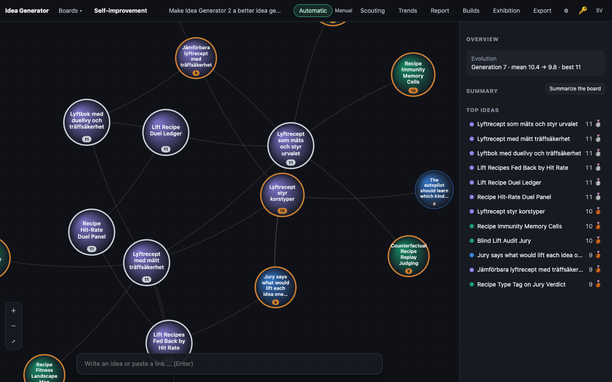
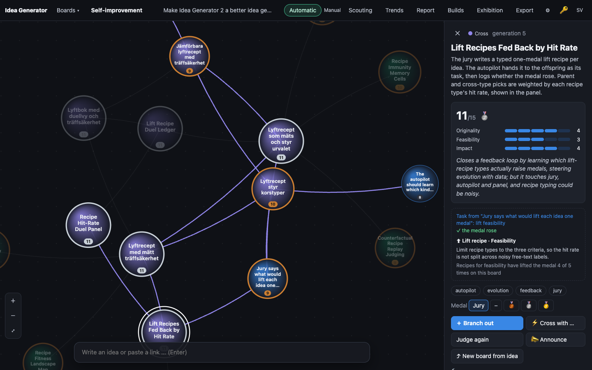
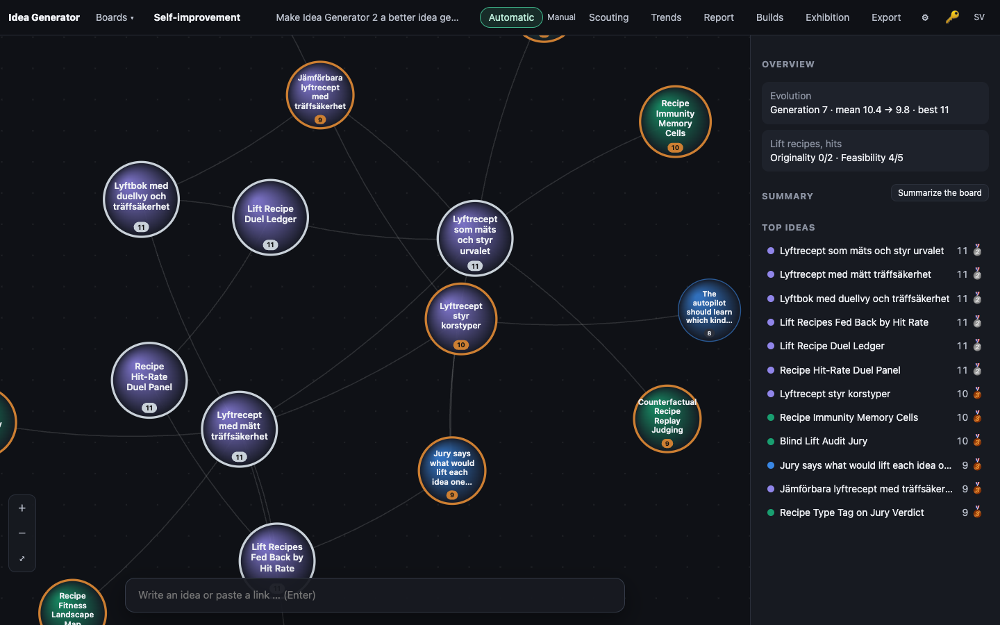

# 0001 · Lift Recipes Fed Back by Hit Rate

> The jury writes a typed one-medal lift recipe per idea. The autopilot hands it to the offspring as its task, then logs whether the medal rose. Parent and cross-type picks are weighted by each recipe type's hit rate, shown in the panel.

## Why the jury picked it

Originality 4, feasibility 3, impact 4 (11/15). The jury liked that it closes a feedback loop: evolution learns from data which kinds of advice actually raise medals. It worried that the idea touches the jury, the autopilot and the panel at once, and that typing recipes could be noisy.

## What I built

**What a user sees.** Open any idea the new jury has judged, and under the score there is a dashed box:

- **⬆ Lift recipe · Feasibility**: the one change the jury says would earn this idea the next medal.
- Below it: *"Recipes for feasibility have lifted the medal 4 of 5 times on this board."*
- If the idea was itself bred under a recipe, the box starts with *"Task from "‹parent›": lift feasibility"* (click it to jump to the parent) and then **✓ the medal rose**, **✗ the medal did not rise**, or *waiting for the jury*.

With no idea selected, the overview gets a second card under Evolution: **Lift recipes, hits: Originality 0/2 · Feasibility 4/5**.

**How it works.**

- **Jury** (`server/llm.ts`): the judge schema gets two new fields, `liftType` (an enum of the three criteria) and `lift` (one change, at most 25 words). They come *after* the scores in the schema so that writing the recipe cannot pull the scores. A recipe only counts if it is whole: a known type and a non-empty change. Otherwise both are stored as null.
- **Typing** is the three jury criteria and nothing else. The jury's own warning was that free-text recipe types would be noisy and split the statistics into crumbs, and a fixed set of three is the simplest answer to that.
- **Handing it on** (`server/engine.ts`): when an idea is branched, its recipe goes into the prompt as the task ("every new idea must carry out exactly this change"). In a cross, `pickRecipe()` takes whichever parent's recipe type has the better hit rate on the board. Gold ideas hand nothing on, because there is no next medal.
- **Logging**: each child stores `lift_type`, `lift_from` (the parent) and `lift_base` (the parent's medal at breeding time). Storing the base matters: a parent can be re-judged or hand-medalled later, and the comparison should be against what the child was asked to beat. A hit is the child's medal above `lift_base`. No separate log table: the hit rate is computed from the ideas themselves by the pure `liftStats()` in `public/js/evolve.js`, so the server and the browser count the same way.
- **Weighting** (`breedScore()` in `evolve.js`): tournament selection now compares fitness plus `(smoothed hit rate − 0.5)` of the idea's own recipe type. The rate is Laplace-smoothed, (hits+1)/(tries+2), so it starts at 0.5 (no nudge) and stays strictly within ±0.5. **This is deliberately weak**: it can only reorder ideas the jury scored the same, never beat a full point of score. Ties are common (most ideas land at 9–11), so it does steer, but the calibrated jury stays in charge.
- **Database** (`server/db.ts`): five new columns on `ideas`. `openDb()` adds them to older databases with `ALTER TABLE` if they are missing, since the live `data/ideas.db` already exists.
- **Panel** (`public/js/app.js`, `i18n.js`, `style.css`): `liftBlock()` and `liftOverview()`, text nodes only, in Swedish and English.

## How I verified it

- `npm test`: **71 tests pass** (64 before, 7 new).
  - `test/score-evolve.test.ts`: what counts as a hit (including hand-set medals, unjudged children and unknown types), the smoothing, which ideas may hand on a recipe (not gold, not unjudged), how a cross picks between two recipes, that the nudge breaks ties but never beats a point of score, and a 3,000-move statistical check that between two equal ideas the one whose recipe type keeps working is picked as a parent more often.
  - `test/api.test.ts`: the whole loop through the HTTP API with the fake LLM. The jury writes a recipe and the type is normalised. Branching puts the recipe into the expand prompt, and all three children store type, parent and base and count as hits once judged silver. A cross picks the parent recipe with the better record. A recipe with an unknown type is dropped. A second test builds an *old-schema* database file and checks that `openDb()` migrates it.
- Screenshots with `tools/shoot.ts` against a copy of the live board 4.

**An honest caveat about the screenshots.** The live database has no recipes yet: every idea on it was judged before this build, and the screenshot tool makes no model calls. So for 02 and 03 I **staged** recipe data in the browser's state with `--eval`. I set a recipe on "Jury says what would lift each idea one medal" and marked eight of its descendants as bred under it (five feasibility tasks, three originality tasks with a silver base). The numbers you see (4/5, 0/2) come from the real `liftStats()` on those staged fields and the real scores. The recipe texts are mine, not the jury's. The real thing appears as soon as the server restarts with this code and the jury judges new ideas.

## Screenshots

## What I left out

- **Cross-type hit rates.** The pitch also mentions weighting *cross types* (branch versus cross) by hit rate. I only weight by recipe type, plus the choice of recipe within a cross. Counting branch versus cross per recipe type would need more data than a board makes in a day before it means anything. The next step would be to let `mutationRate` follow the hit rate of branch versus cross children.
- **Recalibration.** I changed the judge's schema, and CLAUDE.md says to re-run `npm run calibrate` whenever that happens. I could not: it costs money and is outside the build agent's allowlist. The recipe fields come after the scores, so I expect little drift, but that is a guess, not a measurement. I added a "Calibration is due" note to CLAUDE.md's Measured section.
- **The hit is crude.** "Medal above the parent's" ignores whether the child actually *did* what the recipe said; a child can rise for other reasons. Checking that would take a second jury call per child.
- Recipes on hand-medalled ideas that were never judged: they have no recipe, so they hand nothing on.

## For the film

The loop's first build was about the loop itself: the app now asks its jury not just "how good is this?" but "what would make it better?", and then keeps score on whether that advice was any good. The awkward moment was the screenshot: the feature is about history, and a fresh feature has none, so the pictures show staged data. They say so.

---

## Postscript from the builder (written afterwards, by a human-supervised Claude Code session)

The feature merged cleanly, and then the app fell over. While "committing what the agent left uncommitted", the builder also committed the worktree's `node_modules`, which is a symlink to the main checkout's. `.gitignore` said `node_modules/`, and a trailing slash only matches directories, not symlinks. The merge replaced the live app's real `node_modules` with a link to itself, and the restarted server could not find its one dependency.

The agent did nothing wrong here: the bug was in the loop around it. The fix, in the same hour: `node_modules` and `data` are now ignored in every worktree, symlinks included, and the builder refuses any branch that touches them. That rule comes with a regression test and a line in CLAUDE.md.
