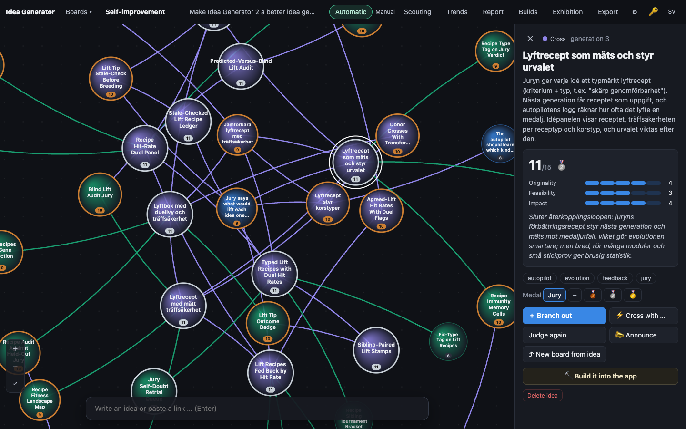
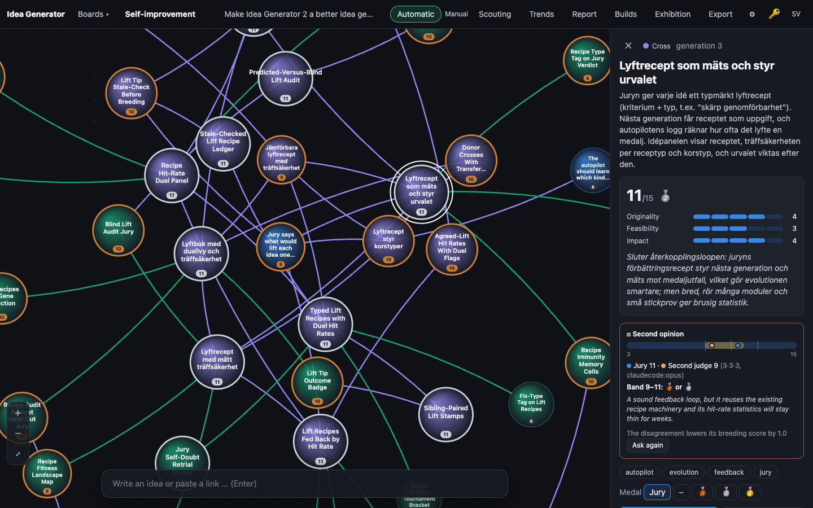
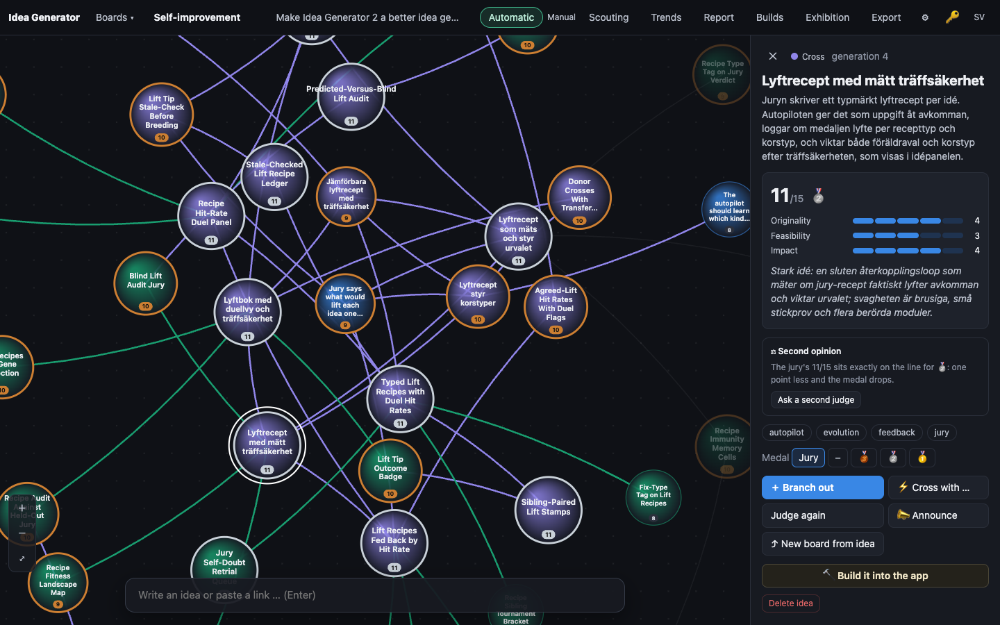

# 0002 · Jury Self-Doubt Retrial Queue

> The jury flags verdicts where its score sits at a medal threshold, or where its recipes keep failing. A second judge re-scores them blind with another model. Disagreements are shown in the panel as a confidence band and lower the idea's selection score.

## Why the jury picked it

Originality 3, feasibility 4, impact 4 (11/15). The jury saw it as a direct answer to the board's goal of a sharper and more honest jury: a blind second opinion on borderline verdicts makes uncertainty visible. Its two worries were the extra judge cost, and that "flagged by failing recipes" was loosely defined.

## What I built

**What a user sees.** Open an idea whose jury sum is exactly 9, 11 or 13, the sums where one point less loses the medal. Under the score there is now a **⚖ Second opinion** box.

- **Before the second judge has spoken**, it says *"The jury's 11/15 sits exactly on the line for 🥈: one point less and the medal drops."* and has an **Ask a second judge** button. While the second judge works, a spinner reads *"The second judge is scoring …"*.
- **After**, it shows a **confidence band**: a bar over the whole 3–15 scale with thin lines at the medal thresholds, a gold band from the lower to the higher sum, a blue dot for the jury and an orange dot for the second judge. Under it: *"Jury 11 · Second judge 9 (3·3·3, claudecode:opus)"*, then the verdict line (*"Band 9–11: 🥉 or 🥈"*, *"Band 11–12: same medal"*, or *"The judges agree: 11/15"*), the second judge's own reason, and *"The disagreement lowers its breeding score by 1.0"*. The box border turns red when the medals differ and green when they agree.
- In the board's and the app's model settings there is a new role, **Second judge (blind)**, default `claudecode:opus`.

On the self-improvement board this happens by itself: every verdict that lands on a medal edge is queued for a second opinion in the background. On other boards it only happens when someone clicks the button, so nobody's ordinary board starts costing more.

**How it works.**

- **The flag** (`onMedalEdge()` in `public/js/score.js`): the jury's sum is exactly a medal threshold, and the medal is not hand-set. That is all. Edge verdicts are the ones where judge noise flips the medal, and on this board the medal decides what gets built.
- **The second judge** (`server/engine.ts`): `queueRetrial()` runs right after `judge()` saves an edge verdict on a self-improvement board. It calls the same `llm.judge()` with the board's guidance and goal, but with the `retrial` role's model. **It is blind by construction**: the judge prompt only ever contains the idea, the goal and the keyword vocabulary, never earlier scores, and the test asserts that the jury's reason and sum are not in the second judge's prompt. If both roles point at the same model the retrial is skipped, since the idea asked for *another* model. Cost goes on the board's ledger like every other call, so the board's daily dollar limit covers it.
- **Stale answers are dropped.** If the jury re-judges the idea while the second judge is thinking, the second opinion is thrown away rather than pinned to scores it never saw. Re-judging also clears any old second opinion (`saveJudgement()` sets `retrial = NULL`), and the new edge verdict is retried again.
- **Storage** (`server/db.ts`): one `retrial` TEXT column with `{originality, feasibility, impact, reason, model, at}`. `openDb()` adds it to older databases.
- **The band** (`confidenceBand()` in `score.js`): low and high sum, the gap, both medals, and whether the medals agree. Pure, so the browser, server and tests share it.
- **Selection** (`doubtPenalty()` in `public/js/evolve.js`): `breedScore()` subtracts half the gap. A 13 that the second judge puts at 11 breeds like a 12. Disagreement in *either* direction costs, because it is uncertainty, not a better verdict. A hand-set medal is a person's decision and costs nothing. **The medal itself never changes**: it still comes from the jury's sum in code. I chose half the gap so the penalty means "somewhere between the two judges", and because the second judge is not calibrated (see below), it should not get the whole say.
- **Panel** (`public/js/app.js`, `style.css`, `i18n.js`): `doubtBlock()`, text nodes only, Swedish and English. A `retrying` event on the board bus keeps the spinner in sync across browsers.
- **Route**: `POST /api/ideas/:id/retrial` (400 `not_judged` for unjudged ideas, 409 if one is already running).

## How I verified it

- `npm test`: **78 tests pass** (73 before, 5 new).
  - `test/score-evolve.test.ts`: which sums are on the edge (9, 11, 13 yes; 8, 10, 12, 14 no; hand-set medals no), the band and medal agreement, malformed second opinions, the penalty in both directions, no penalty for a hand-set medal, that an undisputed 12 now outbreeds a 13 the second judge put at 9, and that the medal stays gold.
  - `test/api.test.ts`: the whole loop with the fake LLM, which answers differently per model. On a self-improvement board, an 11 gets a second call on `claudecode:opus` whose prompt does not contain the jury's verdict; the stored second opinion, the band and the breeding score are right; the board payload carries it; re-judging clears it and asks again; a 10 gets no second call; same model for both roles gets no second call. On an ordinary board an edge verdict gets no automatic call, the button route works, and an unjudged idea gives 400. The old-database migration test now also checks the new column.
- Screenshots with `tools/shoot.ts` against a copy of the live board 4.

**An honest note about the screenshots.** The screenshot tool makes no model calls and every idea on the live board was judged before this build, so no idea has a real second opinion yet. Screenshot 03 is real and unstaged: an 11/15 idea showing the edge warning and the button. For 02 I **staged** a second opinion in the browser's state with `--eval` (scores 3·3·3 and a reason I wrote). The band, the verdict line and the penalty you see are computed by the real `confidenceBand()` and `doubtPenalty()`; the second judge's words are mine, not Opus's.

## Screenshots

## What I left out

- **"Recipes keep failing" as a second trigger.** The jury itself called this loosely defined, and I agree: a recipe type with a poor hit rate says the *advice* is weak, not that the *score* is wrong. I flag only medal edges. If someone wants it, the natural form is: also retry ideas bred under a recipe type with at least three tries and a hit rate under a third.
- **Calibration of the second judge.** CLAUDE.md asks for `npm run calibrate` whenever a judge's model changes. I added a new judge on Opus and could not calibrate it: that costs money and is outside the build agent's allowlist. Opus is a stronger model than the calibrated Sonnet, but how it scores on this scale is unmeasured. This is the main reason the second opinion only takes off half the gap and never touches the medal. Next step: `npm run calibrate -- --model claudecode:opus`.
- **Gating the builder.** A 13 starts a build the moment the jury says so; the second opinion arrives a few seconds later and does not stop it. Holding gold-edge builds until the second judge agrees would be the honest next step, but it changes the builder's trigger, and I did not want to touch the loop that builds me in the same build.
- **Cost.** On board 4 most ideas land on 9 or 11, so a large share of verdicts will get a second Opus call. The board's daily dollar limit still applies, but the spend per idea goes up. A toggle per board would be easy to add.
- No band in the canvas or the Markdown export; only the panel.

## For the film

The before picture says it plainly: the jury gave an idea 11 out of 15, exactly the silver line, and printed it with total confidence. Now the app admits when a verdict is one point from a different medal and asks a second judge who has not seen the first answer. The awkward part is the same as last time: a feature about history arrives with none, so the band in the picture is staged, and it says so.
