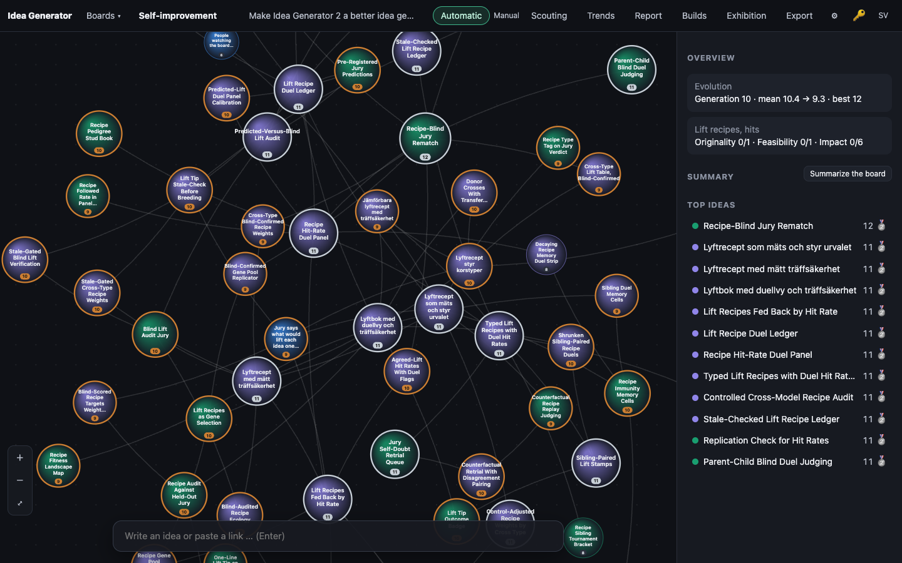
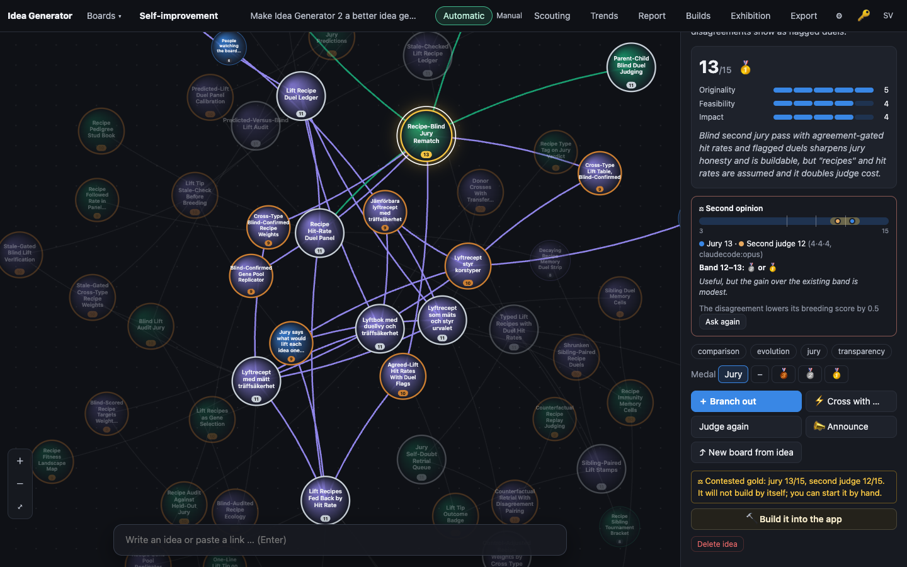
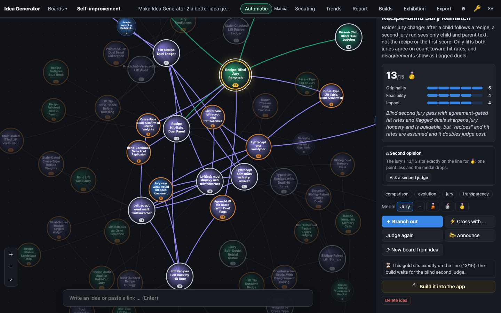
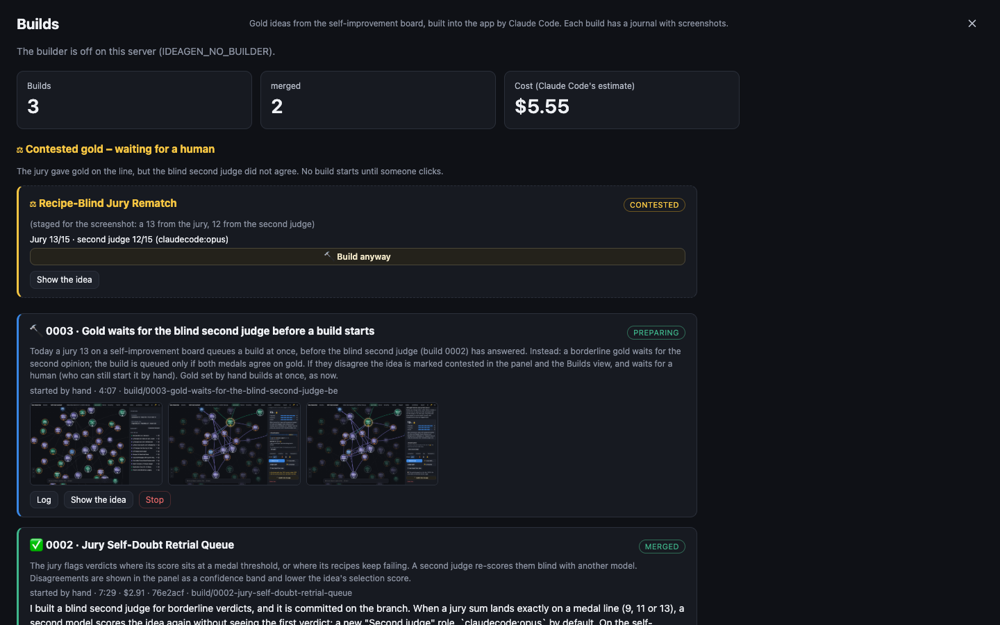

# 0003 · Gold waits for the blind second judge before a build starts

> Today a jury 13 on a self-improvement board queues a build at once, before the blind second judge (build 0002) has answered. Instead: a borderline gold waits for the second opinion; the build is queued only if both medals agree on gold. If they disagree the idea is marked contested in the panel and the Builds view, and waits for a human (who can still start it by hand). Gold set by hand builds at once, as now.

## Why the jury picked it

This build was started by hand, so no jury verdict came with it. The case for it is simple. Build 0002 added a blind second judge for verdicts on a medal edge, but it only drew a band. A borderline 13 still went straight to the builder, which spends several dollars and changes the app's own code. So the doubt that 0002 measured had no effect on the one decision that costs the most.

## What I built

**What a user sees**
- **The idea panel, gold on the line, no second opinion yet:** above the build button it says "This gold sits exactly on the line (13/15): the build waits for the blind second judge." The *Second opinion* block from 0002 sits just above it, with the spinner while the second judge works.
- **The second judge also gives gold:** the build is queued as a jury build, exactly as before, only a minute later.
- **The second judge gives less:**
  - the panel shows a gold-bordered note: "Contested gold: jury 13/15, second judge 12/15. It will not build by itself; you can start it by hand."
  - the board gets a toast.
  - the Builds button shows a ⚖ count.
  - the Builds view gets a section, *Contested gold – waiting for a human*, with one card per idea: both sums, the second judge's model, **Build anyway** and **Show the idea**.
- **Unchanged:** clear gold (14–15) and gold set by hand build at once.

**How it works**
- `public/js/score.js`: a new pure `goldGate(idea)`. It returns `null` for anything that is not a jury gold (a hand-set medal counts as the human's call). Otherwise it returns `'build'` for 14–15, and for a 13 it returns `'waiting'`, `'agreed'` or `'contested'`, depending on the second judge's sum. A malformed second opinion counts as none.
- `server/engine.ts`:
  - `judge()` no longer calls `onGold` for a gold that is about to get an automatic retrial.
  - `retrial()` checks the gate after it saves the second opinion. `'agreed'` calls `onGold(idea, 'jury')`, which still goes through the builder's daily cap and duplicate check. `'contested'` emits a `contested` board event.
  - If the second judge would be the same model as the jury, no retrial runs, so the gold builds at once as before. Nothing can get stuck waiting for a judge that never comes.
- `server/app.ts`: `GET /api/builds` now also returns `contested`, which lists the ideas on self-improvement boards whose gate is `'contested'` and that have no build.
- `public/js/app.js`, `public/js/builds.js`, `public/js/i18n.js` (Swedish and English), `public/style.css`: the panel note, the toast, the button count and the Builds section. Every piece of text goes in through `h()`.

**Decisions I made alone**
- **Only contested ideas appear in the Builds view, not waiting ones.** The live board has old 13s from before the second judge existed. Listing them all as "waiting" would have been noise. The panel still shows them as waiting, and *Ask a second judge* settles them.
- **A failed or stale second opinion leaves the gold waiting.** It does not fall back to building. A human can ask again or build by hand. I chose to fail closed, because the build is the expensive step.

## How I verified it

- **`test/score-evolve.test.ts`:** the gate for silver, unjudged, 14, 13 with no opinion, 13 with agreement (including a higher second sum), 13 contested, hand-set gold and a malformed opinion.
- **`test/builder.test.ts`, new engine test:**
  - The fake second judge is held on a promise. No build is requested while it is held. Once it is released, exactly one jury build is requested.
  - A second judge that says 12 requests no build and emits `contested` with 13 and 12. The jury's scores stay untouched.
  - A hand-set gold afterwards still builds at once.
- **`test/api.test.ts`:** a contested 13 shows up in `/api/builds` with both sums and the model, and an agreed one does not.
- **One existing test changed.** The old engine test expected a jury 13 to build at once, which is exactly the behaviour this build removes. I raised its fake jury to 14 (a clear gold). It still asserts that gold builds immediately, and that other boards never build. I did not delete or weaken any assertion.
- **`npm test`:** 81 of 81 pass (up from 78).
- **Screenshots:** I looked at all three. The live data has no jury 13 on board 4 (its highest jury sum is 12), so the "after" pictures are staged in the browser only. In headless Chrome I set idea 81's scores to 5·4·4, and for the Builds view I patched `fetch` to add one contested entry. The database copy was never touched. The UI in the pictures is the real code; only the numbers were planted.

## Screenshots

## What I left out

- **Off the medal edge.** A 14 still builds without a second opinion, and so do ideas where both roles share a model. Gating every gold would double the jury cost for the build path.
- **Clearing the contested state.** It ends when someone builds the idea, re-judges it, or hands it a medal. There is no "dismiss" button.
- **Next step:** count how often contested ideas, built by hand anyway, end up merged rather than declined or failed. That would show whether the second judge's doubt predicts anything.

## For the film

The test that mattered held the second judge's answer on a promise and checked that the builder stayed quiet until it was released. The awkward part was the screenshots: the live board had no jury 13 at all, so I staged the numbers in the browser and wrote that down here.
