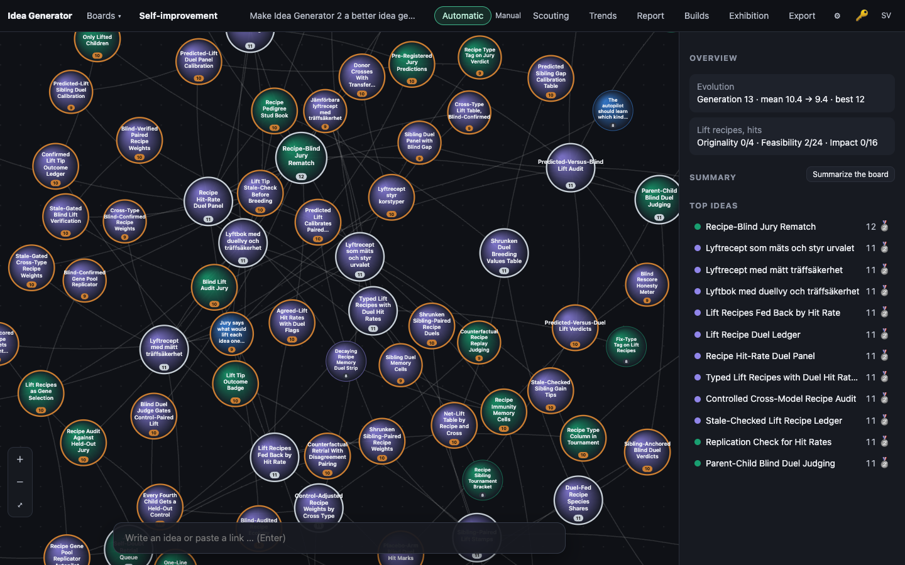
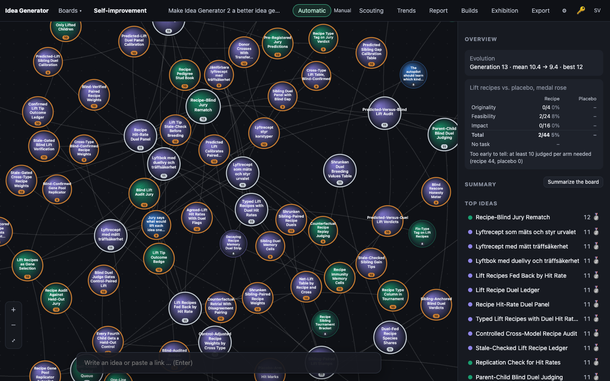

# 0004 · Placebo Trials for Recipes

> Borrowed from clinical trials: some breeds get a randomly assigned placebo task, a vague 'improve it', instead of the recipe. The overview compares recipe, placebo and no-task arms per type, so users see whether recipes beat chance.

## Why the jury picked it

The jury scored it 11/15 (originality 4, feasibility 4, impact 3), which by itself is silver, and it reached the builder as gold. The jury liked it because a randomized control arm makes the lift-recipe feedback loop honest. It also warned that the result is only conclusive with enough samples and a clear arm design.

## What I built

**What a user sees.** In the board overview, the old one-line "Lift recipes, hits" is now a small table titled **Lift recipes vs. placebo, medal rose**:

- one row per recipe type (originality, feasibility, impact), with a *Recipe* column and a *Placebo* column, each showing hits/tries and a percentage
- a *Total* row
- a *No task* row: children of parents below gold that had no recipe at all
- a plain reading underneath: *Too early to tell* until both arms have at least 10 judged children. After that it says *Recipes beat placebo*, *make no clear difference* (within 10 percentage points) or *Placebo beats recipes*.

A child's idea panel now says which arm it was in. It reads *Task from …: lift impact*, *Placebo from …: told only "improve it" (the impact recipe was withheld)* or *Control from …: the parent had no recipe*, each followed by ✓/✗ once it has been judged.

**How it works.**

- `public/js/evolve.js` has a new pure function, `assignArm(parents, stats, rng)`. When a recipe exists (from `recipeOf`, or from `pickRecipe` for a cross), a lot with `PLACEBO_RATE = 0.2` sends the breed to the placebo arm. The placebo arm keeps the same type, parent and base, but gets no change text. With no recipe, the breed goes to the no-task arm, measured against the best parent below gold. All-gold or unjudged parents mean no arm. `armOf`, `armHit`, `trialStats` and `trialVerdict` do the counting.
- `liftHit()`, and so `liftStats()` and `breedScore()`, now count **only the recipe arm**. Without that, a lucky placebo would have raised the hit rate of the type it replaced and steered breeding: the control would contaminate the treatment.
- `server/llm.ts`: in the placebo arm the prompt gets only `PLACEBO_TASK` = "Your task: improve it." It does not get the recipe, the criterion or the words "lift recipe". The no-task arm gets no task line.
- `server/engine.ts`: `doExpand` and `doCombine` call `assignArm` and store `arm` with the lift. The lot is `deps.trialRng` (default `Math.random`), so tests can fix it.
- `server/db.ts`: a new `lift_arm` column, which `openDb()` adds to older databases. Old rows that have a `lift_type` and no arm count as the recipe arm, since that is what they were.
- `public/js/app.js`, `i18n.js` (Swedish and English), `style.css`: the table and the panel lines, all text nodes via `h()`.

## How I verified it

- `npm test`: 85 tests pass (81 before).
  - In `test/score-evolve.test.ts`:
    - placebo share ≈ 0.2 over 4000 lots with a seeded PRNG
    - a placebo keeps the recipe's type, base and parent but not its change
    - a cross keeps `pickRecipe`'s choice
    - no-task arm against the best non-gold parent, and no arm for gold or unjudged parents
    - per-arm counting, including old rows with no arm
    - `liftStats` ignores placebo and no-task children
    - all four verdicts
  - In `test/api.test.ts`, end to end through the HTTP API with the fake LLM:
    - with the lot fixed at 0, the expand prompt contains "Your task: improve it." and neither the recipe text nor "lift recipe" or "raising its"
    - the children are stored as `placebo` with the withheld type, and `liftStats` stays at 0 tries
    - a parent with no recipe breeds `none` children with no task line
    - the old-database test now also checks the `lift_arm` column
  - The existing recipe test now pins the lot to 0.99 (never placebo) and also checks `liftArm: 'recipe'`. Without that pin it would have failed at random one time in five. I did not weaken any assertion.
- Screenshots with `tools/shoot.ts` against a copy of the live data.

## Screenshots

## What I left out

- **Significance.** The verdict is a raw rate difference with a 10-sample floor and a 10-point dead zone, not a statistical test. A next step could be a Fisher exact test or a beta-posterior "probability recipes beat placebo".
- **Per-type verdicts.** The table shows the arms per type, but the verdict only covers the total, because per-type samples will be tiny for a long time.
- **A settings knob for the placebo rate.** It is a constant (0.2). It costs about one in five recipe breeds, which is the price of knowing.
- **The no-task arm is not per type** (there is no type to withhold), and it will be rare, since the current jury writes a recipe almost every time.
- **Breeding ignores the trial.** Recipes keep steering selection even if placebo turns out to beat them. Feeding the verdict back (for example, weighting by the recipe's margin over placebo instead of its raw hit rate) is the natural follow-up, once there is data.

## For the film

The "before" screenshot already held the uncomfortable number: on this board, recipes had lifted the medal 2 times in 44, and nobody knew whether "improve it" would do better. The loop has spent three builds refining recipes. This build is the first to ask whether they work at all, and its honest answer today is "too early to tell".
