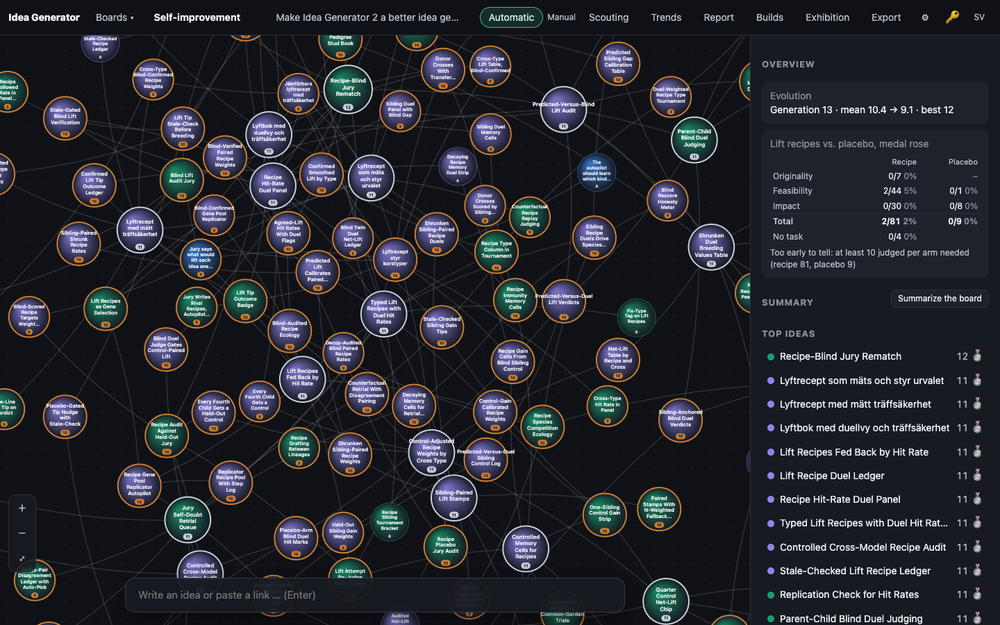

# 0005 · Diversity pressure: the autopilot notices a monoculture and breeds outside it

> On this very board almost every idea for hours has been a variant of lift recipes: tournament selection keeps crossing the strongest ideas, and they all share one lineage and the same keywords. Measure how concentrated the board is (share of recent ideas in the dominant keyword cluster or lineage); when one theme dominates, the autopilot picks at least one parent from outside it, or expands a neglected idea. The overview shows a diversity gauge over time and says when the pressure kicked in, so watchers can see the app noticing its own monoculture.

## Why the jury picked it

It didn't. This build was started by hand, with no jury verdict. The "before" screenshot makes the case anyway: nearly every ball on the board has "recipe", "lift" or "placebo" in its title.

## What I built

**What you see.** The board overview has a new *Diversity: share of the top theme* box above the lift-recipe table:

- a line naming the board's dominant theme now, e.g. *"lift recipe" in 23 of the last 24 ideas (96%)*;
- a bar gauge with one bar per bred idea, showing that theme's share of the 24 ideas up to it, with a dashed monoculture line at 60%. Bars above the line are orange and the rest blue. Hovering a bar shows its idea number, its theme and the share;
- a state line: *Monoculture since idea #63 (date, time): the autopilot breeds outside "lift recipe"*, or *Diverse enough*;
- what the pressure has done: *🌱 N bred outside it (latest …); K of J judged really left the theme*. Until the autopilot has taken a step under pressure, it says so instead.

An idea that the autopilot bred under pressure shows *🌱 Diversity pressure: bred outside the "lift recipe" monoculture* in its panel, plus whether the jury then tagged it with something else (*and it left the theme*) or not (*but the jury still tags it with it*).

**How it works.**

- `public/js/evolve.js`:
  - `diversity()` takes the last 24 bred ideas that the jury has tagged (seeds and guests excluded) and counts how many carry each keyword. The keyword with the highest count is the theme, alphabetical on a tie. With at least 12 such ideas and a share of 0.6 or more, it is a monoculture.
  - `nextMove()` uses that result. In a monoculture the first parent's tournament draws only from ideas without the theme keyword, while the second parent still comes from the whole pool, and a mutation step expands the best unexpanded idea outside the theme. The move carries `escape: <keyword>`. Within the outside pool the tournament still ranks by `breedScore()`, so the jury's score still picks which outsider. A board that is not a monoculture consumes exactly the same random draws as before, so it breeds exactly as before (a test checks this).
  - `diversitySeries()` and `pressureStats()` compute the gauge, the start of the current run above the line, and the escape counts.
- `server/engine.ts`: `autoStep()` passes `move.escape` to `doExpand`/`doCombine`, which store it on the child.
- `server/db.ts`: a new `escape_kw` column (added to older databases by `openDb()`), exposed as `idea.escape`.
- `public/js/app.js`, `i18n.js` and `style.css`: the overview box (an SVG gauge built with `dom.js` `svg()`, all text as text nodes) and the panel note, in English and Swedish.

I used keywords rather than lineage. The jury already tags every idea with 2–4 keywords from a shared vocabulary that it is told to reuse, so they make a cheap and readable theme label. A lineage cluster would need graph analysis, and the overview couldn't name it in words.

## How I verified it

- 5 new tests, plus one assertion added to an existing test (85 → 90 tests). `npm test` passes.
  - `diversity`: the share, the alphabetical tie, seeds and guests excluded, too few ideas, below the line, and only the window counting.
  - Pressure in `nextMove`: over 200 seeded runs every combine takes a parent from outside the theme and carries `escape`. The strongest outsider wins the first tournament most of the time. A mutation expands the best outsider, and `diversity:false` restores the old pick.
  - No pressure when there is no monoculture or nothing lies outside it. A keywordless board gives exactly the same moves as with the feature off.
  - The gauge: series length, the start of the current monoculture run, and the escape and "left the theme" counts.
  - The real engine (`autopilot.test.ts`): 14 strong "lift recipe" ideas and 2 weaker outsiders. Three `autoStep`s each produce children marked `escape: 'lift recipe'` with a parent outside the theme, and the neglected ideas get children.
  - The old-database test now also checks that the `escape_kw` column gets added.
- Before writing any code, I measured the live board: "lift recipe" was on 29 of its last 30 bred ideas (the shoot tool's `--eval` printed it into a screenshot).

What went wrong along the way:

1. I first named the column `escape`. SQLite rejected the insert with `near "escape": syntax error`, because `ESCAPE` is an SQL keyword (as in `LIKE … ESCAPE`). I renamed the column to `escape_kw` and kept `idea.escape` in JavaScript.
2. My first engine test failed, and the code was right. I had tagged every idea with both "lift recipe" and "jury", so the two tied, and the alphabetical tie-break made "jury" the theme. That will happen for real: on this board broad tags like "evolution" and "jury" are almost as common as "lift recipe".

## Screenshots

## What I left out

- **Lineage.** The pitch suggests measuring by lineage as well as keyword. I measure only keywords.
- **Broad tags.** A tag like "evolution" can become the "theme" when it is really just the board's subject. A next step would ignore keywords that are on most ideas from the start (a stop-list learned from the seed generation), or measure pairs of keywords.
- **Pressure history.** The gauge shows when the *current* monoculture began, from the keyword data. It does not log every time the pressure switched on and off.
- **Manual breeding is unaffected.** Pressure applies only to the autopilot, and there is no per-board on/off switch (`nextMove` takes `diversity:false`, but the UI doesn't expose it).
- **No measured effect yet.** Whether escapes lead to better ideas, and not just different ones, is open. The overview already counts how many really left the theme. Comparing their medals with in-theme breeds would be the honest next measurement.

## For the film

The gauge came up almost solid orange: by its own measure the board has been a monoculture since idea #63, nearly its whole life. Nobody had noticed until it could count.
