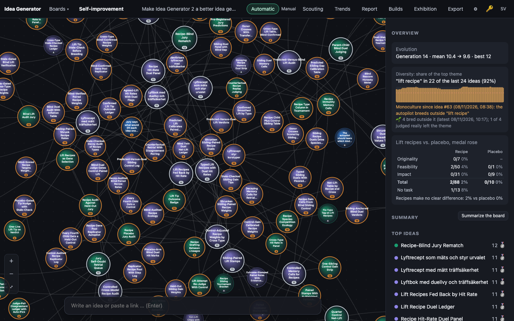
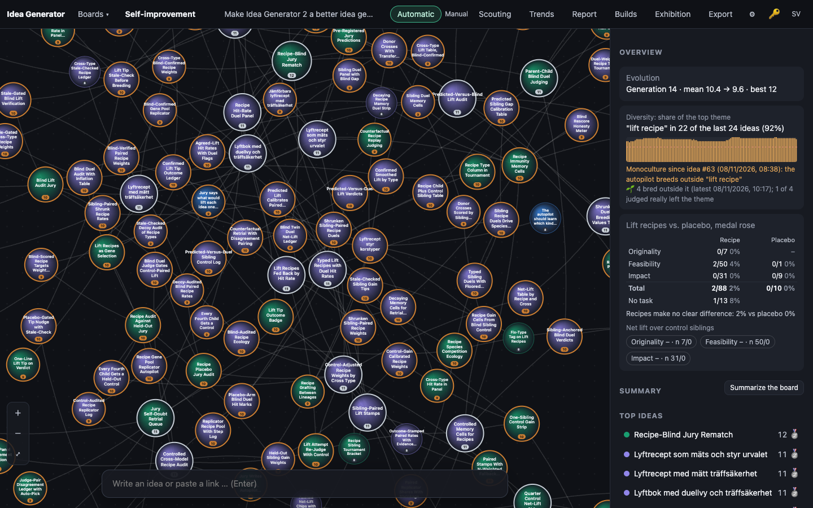
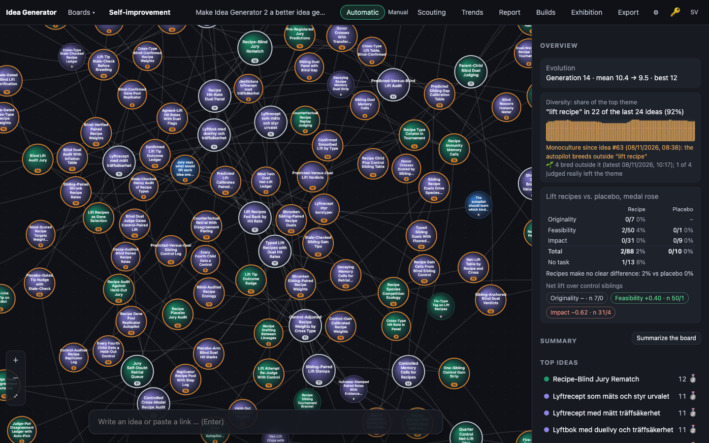
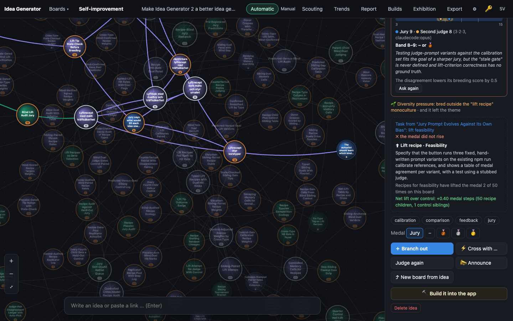

# 0007 · Quarter Control Net-Lift Chip

> Smallest build: the autopilot breeds a no-recipe control sibling for every fourth recipe child. The panel shows one net-lift chip per recipe type (mean medal gain minus control gain, with n), and ties in tournament selection use it instead of raw hit rate.

## Why the jury picked it

Silver, 4 + 4 + 3 = 11/15. A no-recipe sibling bred from the same parents turns the recipe hit rate into a causal measure. A child's medal can rise or fall without any help, by luck or by regression to the mean, and the sibling shows how much. The jury also warned that small n makes the chips noisy and that the siblings cost extra spend.

This is the second attempt. Build 0006 was the same idea. It was interrupted when the server restarted, before the agent had written anything.

## What I built

**What you see.** The overview's *Lift recipes vs. placebo* card has a new row, *Net lift over control siblings*, with one chip per recipe type:

- An example chip reads `Feasibility +0.40 · n 50/1`: the net lift in medal steps, then the number of recipe children and the number of control siblings.
- A chip is green above zero and red below. It shows `–` until both arms have a judged child.
- Hovering a chip or the title explains it.

The idea panel of an idea that carries a recipe shows the same reading for its type, under the hit rate. A control sibling's panel says *Control sibling from "…": same parents, no task (the impact recipe was withheld)*.

**How it works.**

- `public/js/evolve.js`:
  - `'control'` is now a fourth arm next to `recipe`, `placebo` and `none`. It had to be added to `ARMS`. A control child carries a `liftType`, and `armOf()` treats any unknown arm with a type as a recipe child. Without this, every control would have counted as a recipe *hit or miss*, which is the opposite of the point.
  - `CONTROL_EVERY = 4` and `controlDue(n)`.
  - `medalGain(idea)` is medal minus `liftBase`. A fall counts as a negative gain.
  - `netLiftStats(ideas)` gives, per type, n and mean gain for the recipe arm and for the control arm, plus `net`, the difference. `net` is null until both arms have data.
  - `netNudge(net, type)` maps the net lift to `k/(k+2) · net / (2(|net|+1))`, where k is the smaller arm's n. The result is strictly inside ±0.5 and shrinks while there are few controls.
  - `breedScore(idea, stats, net)` uses that nudge instead of the hit-rate nudge once it exists, and falls back to the hit rate otherwise. `nextMove()` computes `net` and passes it to the tournament.
- `server/engine.ts`:
  - After each autopilot cross, `autoStep()` counts the board's recipe-arm crosses. When the new cross is a recipe cross and the count is a multiple of 4, it calls `doCombine()` again on the same parents with a forced task: `{ arm: 'control', type: <withheld type>, change: null, base: <same base> }`.
  - Both children are judged in the same step.
- `server/llm.ts`: `liftTaskText()` explicitly gives the `control` arm no task text.
- `public/js/app.js`, `i18n.js` (Swedish and English), `style.css`: the chips, the panel line and the control-sibling label.

**Decisions I made alone.**

- **Only autopilot crosses get a control.** An expand makes several children at once, so its "sibling" would be a second full expand: two or three extra ideas and judgements instead of one. A person breeding by hand did not ask to pay for an experiment.
- **"Every fourth" counts recipe crosses on the board, not a random lot.** That keeps it deterministic and testable, and keeps spend at roughly +25% on recipe crosses.
- **Unpaired means per type.** I compare means per type rather than pairing each control with its own recipe sibling. That uses all the recipe children, not only the quarter that have a twin. The cost is that the two arms are not perfectly matched.

## How I verified it

- `npm test`: 95 pass (there were 91). New tests:
  - `control siblings: due on every fourth recipe cross`.
  - `net lift: …`: gains including a fall; placebo, `none` and unjudged children left out; a control is not a recipe hit; `null` until both arms have data; `trialStats` counts the control arm.
  - `net lift replaces the hit rate in selection ties…`. A board where impact has the better raw hit rate (4/4) but net lift 0, and feasibility has a worse hit rate (2/4) but net lift +1.5. By hit rate impact would win. With net lift, `nextMove` picks the feasibility parent more often over 3000 draws. The test also checks that the nudge stays strictly within ±0.5, keeps the sign of the net lift, shrinks with few controls, and never beats a point of jury score.
  - `autoStep breeds a no-task control sibling of every fourth recipe cross…` (real engine, fake chat):
    - no control before the 4th recipe cross;
    - the 4th cross brings exactly one control in the same step, with the same two parents, the same type and base, and judged;
    - its combine prompt has no task, while its recipe sibling's prompt had the recipe.
- I looked at every screenshot. On the real data (board 4) the chips all read `–`: there are 88 judged recipe children and 0 control siblings, because no control has been bred yet. To show a populated chip I injected fake control siblings into the browser's in-memory state only (a copy of every fourth recipe cross, with its medal set to the parent's, sometimes one lower). Screenshots 03 and 04 show that. Nothing was written to any database.

## Screenshots

## What I left out

- **Re-judging blind to the recipe** (one of the parent ideas). The jury never sees the task anyway, so the existing judgement is already blind to it.
- **Splitting by cross type.**
- **Controls for expands and for hand breeds.**
- **Any significance test.** The chip shows n, and the shrinkage keeps a single control from swinging selection much.
- **Better grammar.** "1 control siblings" in the panel line is not pretty.
- **Next step:** pair each control with its own recipe twin (store `control_of`), and show a paired difference once there are enough pairs. Pairing removes the parent-quality difference between the arms.

## For the film

Screenshot 03 makes the jury's warning visible. One fake control sibling was enough to turn the feasibility chip green at +0.40, which is exactly the small-n noise the jury predicted. That is why the nudge is shrunk to a third while only one control exists. The real board shows the honest state: 88 recipe children judged, and not one control yet.
