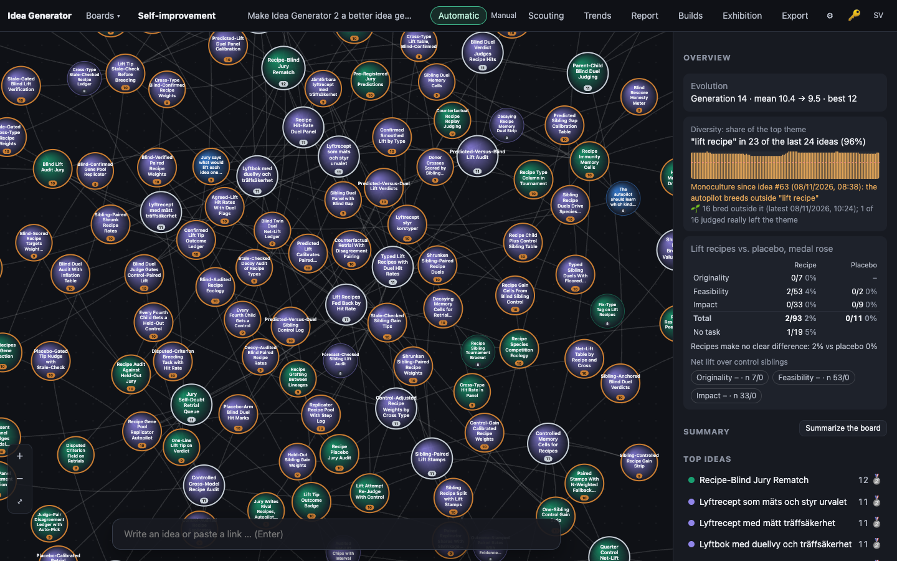
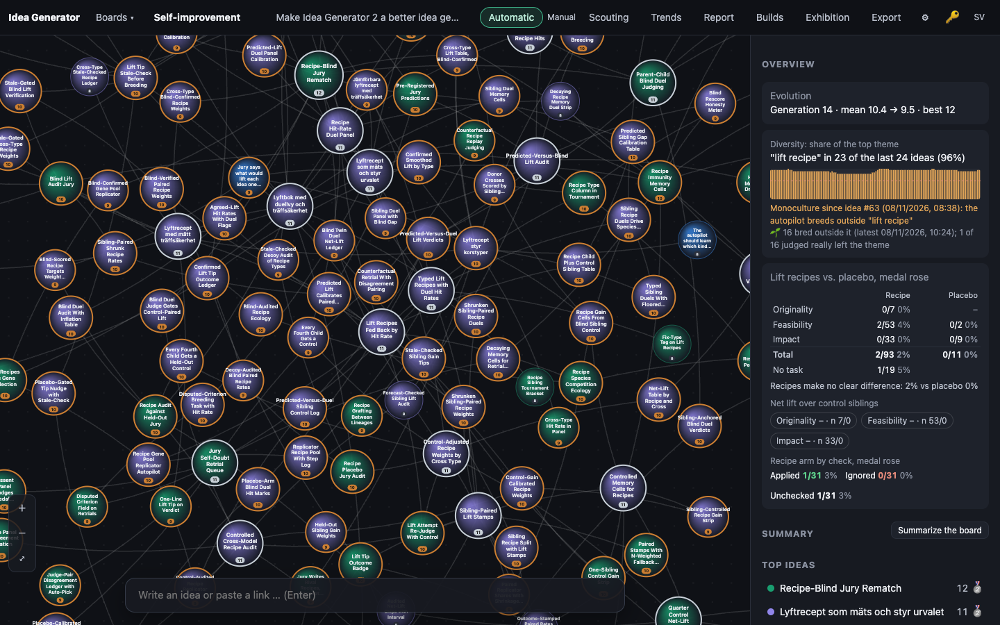
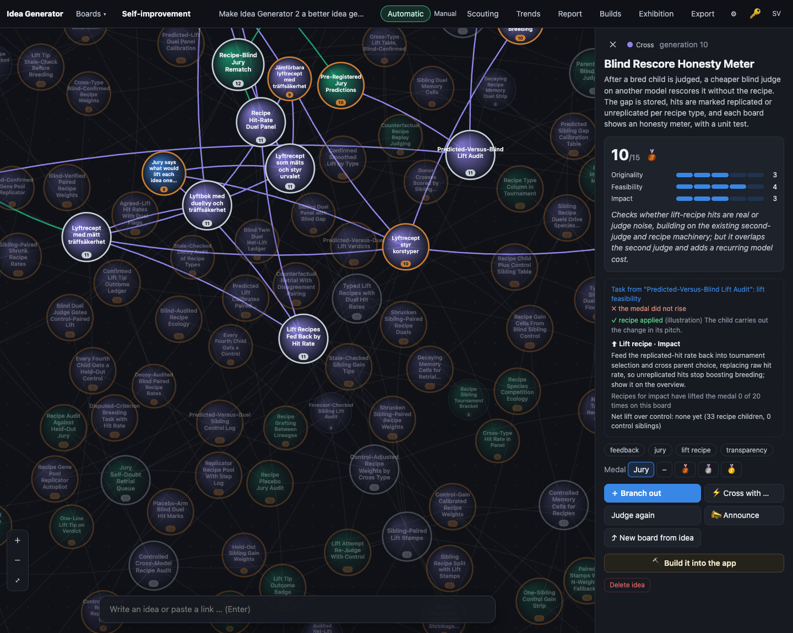
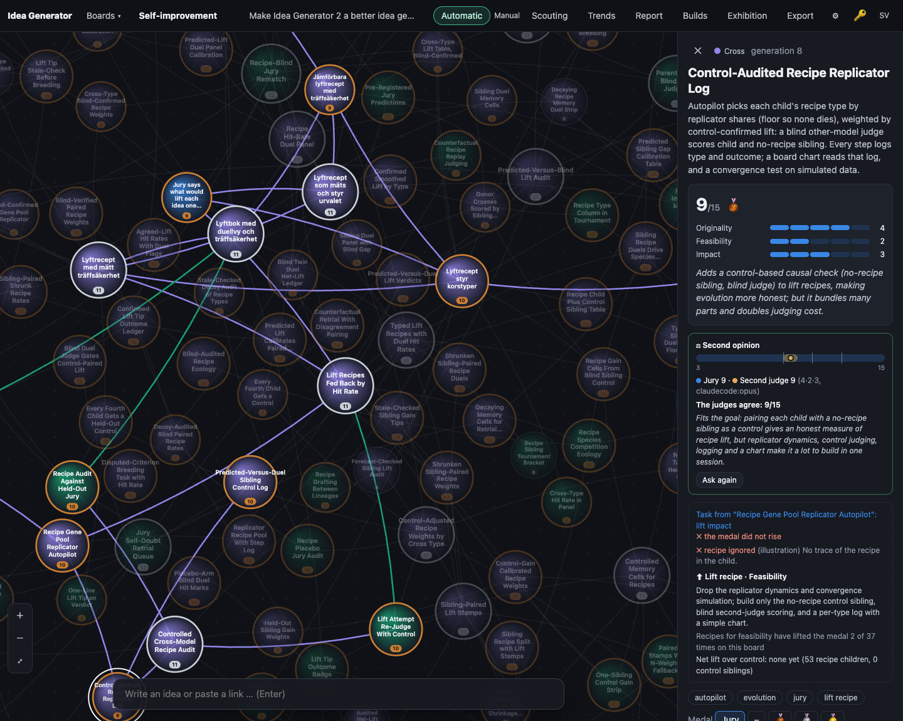

# 0008 · Jury Re-Reads Recipe Against Child

> After a child is judged, the jury is shown parent, recipe and child, and rules whether the child really applied the recipe. Hits count only if applied. The panel shows 'applied' or 'ignored', and the overview splits hit rates by applied status.

## Why the jury picked it

Originality 4, feasibility 4, impact 3 = 11/15. The jury said it fixes a real flaw in how recipe hits are measured: until now, a child counted as a test of its recipe whether or not it actually carried the recipe out. The cost it named is one more model call per child.

## What I built

**What you see.**
- A recipe child's panel has a new line under its task: **✓ recipe applied** or **✗ recipe ignored**, plus the checker's one-sentence reason. A recipe child that has not been checked says *recipe not checked*.
- In the overview, under the net-lift chips, a new row reads **Recipe arm by check, medal rose: Applied h/n · Ignored h/n · Unchecked h/n**. That shows whether children that ignored their recipe are the ones keeping the hit rate down, or the ones inflating it.

**How it works.**
- `server/llm.ts`: a new `checkLift()` call with its own small schema (`liftcheck`: `reason` first, then the boolean `applied`). It sees the parent, the recipe and the child. It never sees scores, the jury's reason or the medal, so a ruling cannot follow the medal. The system prompt asks it to be strict: a vague nod to the change does not count as carrying it out.
- `server/engine.ts`: `judge()` now calls `checkLift(board, idea)` after it saves a verdict. That only does something for recipe-arm children, and only once per child: a re-judge does not re-check, because the text has not changed. It is skipped if the parent's recipe has gone, or has changed type since the breed, because then it is not the recipe the child was handed. A failed or empty check leaves the child unchecked and never fails the verdict. It uses the board's judge model.
- `server/db.ts`: two new columns, `lift_applied` (1/0/NULL) and `lift_check`. They are added to older databases the same way as before. `repo.saveLiftCheck()` writes them.
- `public/js/evolve.js`: `liftHit()` returns null for an ignored child, so it is neither a hit nor a miss in `liftStats()`, the hit rate that steers breeding. I chose that reading of "hits count only if applied" over counting ignored children as misses: an ignored recipe was never tried, so counting it as a miss would blame the recipe for the child's disobedience. Unchecked children (every child bred before this build) still count, so the existing statistics do not suddenly empty out. New: `appliedStatus()`, `appliedStats()`, `APPLIED_STATUSES`.
- `public/js/app.js`, `i18n.js`, `style.css`: `appliedLine()` in the panel and `appliedSplit()` in the overview, in Swedish and English, all as text nodes.

**A deliberate limit.** The placebo table (`trialStats`) and net lift (`netLiftStats`) still keep every recipe child, ignored or not. Those are comparisons between randomised arms. If I dropped the "ignored" children from only one arm, the comparison would be biased, because placebo and control children cannot be checked against a recipe they never got. So the check filters only the raw hit rate, as the idea asked. Once a type has a net lift, that net lift is the tie-break in selection. So in practice the check steers breeding only for types that have no control data yet. I wrote this into CLAUDE.md as a rule.

## How I verified it

- `npm test`: 97 tests pass. There were 95; I added 2.
  - `score-evolve.test.ts`, "recipe check":
    - an ignored child is neither hit nor miss
    - `appliedStats` splits applied, ignored and unchecked
    - only recipe-arm children get a status
    - the placebo table still counts every recipe child
  - `api.test.ts`, "recipe check", end to end with the fake LLM:
    - a seed gets no check
    - expanding under a recipe makes one `liftcheck` call per child, with the parent, the recipe and the child in the prompt, and nothing of the verdict (no reason, no medal)
    - the call uses the judge model
    - an "ignored" ruling is stored and kept out of `liftStats`
    - the board payload carries the ruling
    - re-judging does not re-check
    - an "applied" child counts as a hit
    - an answer with no boolean leaves the child unchecked, and it still counts
    - placebo children get no check
    - a provider that throws during the check still leaves the children judged
  - The old-database test now also checks the two new columns.
- Screenshots with `tools/shoot.ts` against a copy of the live board 4.

**An honest note on the screenshots.** No idea in the live database has been checked yet: the check runs only when a recipe child is judged, and the screenshot server makes no model calls. To show the UI, I set illustrative rulings in the browser's in-memory state with `--eval`: every third recipe child "applied", the next "ignored", the third left unchecked. Their reasons start with *(illustration)*. The numbers in 02–04 are therefore not real rulings. The hits are real (2 of 93 recipe children rose), but which status each child falls under is made up. The first real numbers will appear on the board once the autopilot breeds again.

## Screenshots

## What I left out

- **No back-fill.** The 93 existing recipe children stay unchecked. A one-off "check the old ones" button would cost about 93 calls. That is cheap, but it should be the user's choice, not a side effect of a build.
- **No calibration of the checker.** The jury is calibrated against reference ideas. This new yes/no judge is not. The next step is a small set of reference triples (parent, recipe, child) that clearly did or did not apply the recipe, added to `npm run calibrate`.
- **No per-type split.** The overview shows applied/ignored in total, not per recipe type, to keep the panel short.
- **The recipe text is not stored on the child.** The check reads the parent's current recipe and skips the child if that recipe's type has changed. If the parent is re-judged and keeps its type but gets a new wording before the child is judged, the check reads the new wording. That is rare, because children are judged right after breeding, but it is a real gap. The fix would be a `lift_text` column written at breeding time.

## For the film

Before this build, the board counted 93 recipe experiments, and nobody had ever asked whether the children had done what they were told. The moment the panel first said "✗ recipe ignored", it was showing a ruling I had made up for the camera. The real answers start arriving the next time the autopilot breeds.
