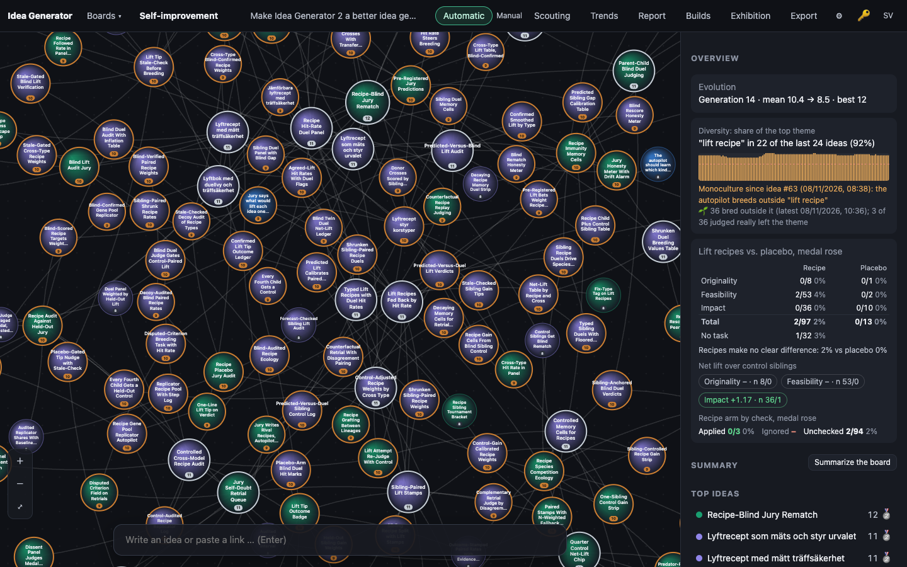
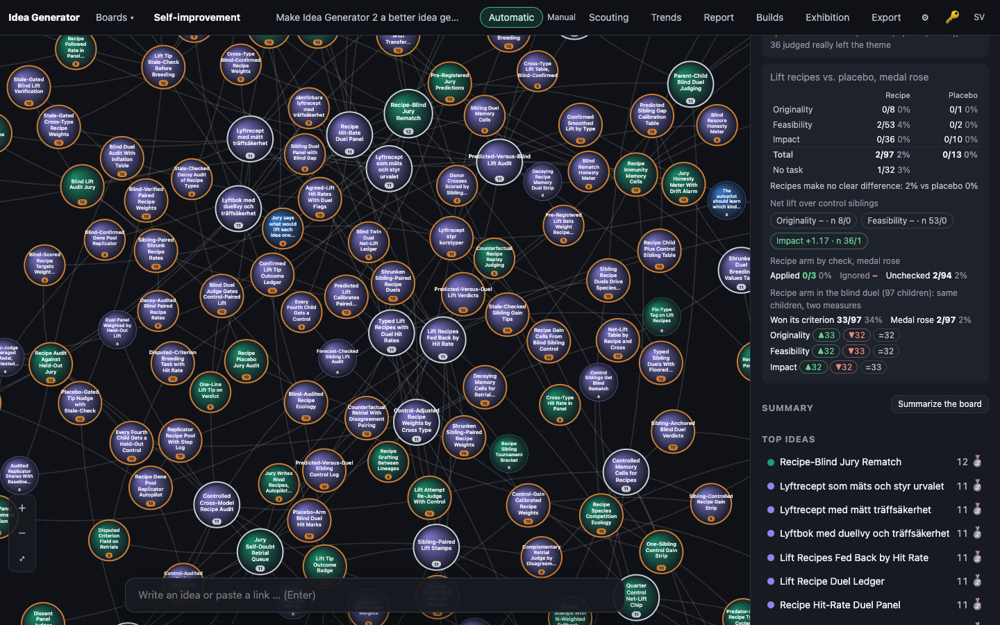
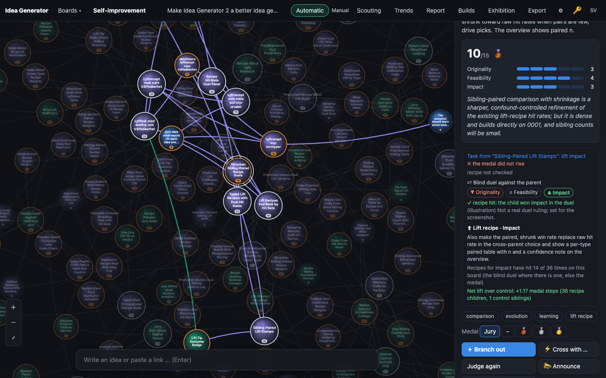
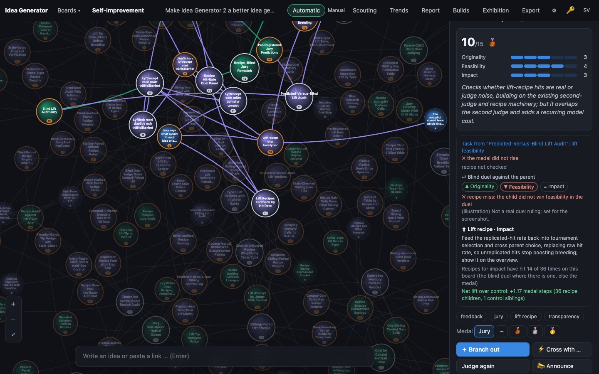

# 0009 · Blind Duel Verdict Judges Recipe Hits

> For board watchers and the autopilot: after a bred child is judged, one extra blind call compares parent and child texts in random order, picking a winner per criterion. Absolute scores and medals stay unchanged. The duel decides recipe hit/miss, shown as per-criterion winner badges beside sibling recipes.

## Why the jury picked it

Originality 4, feasibility 4, impact 3 = 11/15. The jury said a pairwise blind duel is a more honest way to measure recipes than counting medal-threshold crossings, which are noisy. It named two costs: one more call per child, and some overlap with the existing second judge.

## What I built

**What you see.**
- In a recipe child's panel, under the task and the recipe check, there is a new block, **⇄ Blind duel against the parent**. It has three badges, one per criterion: **▲** the child won, **▼** the parent won, **=** a tie. The badge for the recipe's own criterion has a ring around it. Below them, a line reads **✓ recipe hit: the child won impact in the duel** or **✗ recipe miss: …**, followed by the duel's one-sentence reason.
- In the overview, under the recipe-check split, a new row reads **Recipe arm in the blind duel (n children): same children, two measures**. It shows *Won its criterion h/n* next to *Medal rose h/n* for exactly the same children, and under that a tally per criterion: ▲ child won, ▼ parent won, = tie. That row puts the two rulers side by side.
- The hit-rate line under a recipe now says "have hit … (the blind duel where there is one, else the medal)", because the number now means that.

**How it works.**
- `server/llm.ts`: a new `duel()` call with its own schema (`duel`: `reason` first, then `originality`, `feasibility`, `impact`, each `"A"`, `"B"` or `"tie"`; no integers anywhere). The prompt contains only "Idea A: …" and "Idea B: …". There is no recipe, no scores, no medal, and no word saying which idea is the parent.
- `server/engine.ts`: `judge()` calls `duelLift()` right after `checkLift()`. A coin (`deps.duelRng`) decides whether the child is shown as A or as B. The engine maps the answer back to `child`, `parent` or `tie` and stores it, together with `childFirst`, the model and the time. It runs only for recipe-arm children, and only once per child, because a re-judge does not change the texts. If any criterion comes back without a valid pick, or the call throws, the child is left without a duel and the verdict still stands. It uses the board's judge model.
- `server/db.ts`: a new `duel` TEXT column (JSON), added to older databases like the others, and `repo.saveDuel()`.
- `public/js/evolve.js`:
  - `duelHit()`: the child won the recipe's criterion. A tie is a miss, because the recipe was supposed to make that criterion clearly better.
  - `liftHit()` uses `duelHit()` when a duel exists and falls back to the old medal rule when there is none. So `liftStats()`, and through it the hit-rate tie-break, now rest on the duel. The nudge is still Laplace-smoothed within ±0.5.
  - `duelStats()` feeds the overview row.
  - A child that the recipe check ruled "ignored" is still left out of the hit rate.
- `public/js/app.js`, `i18n.js`, `style.css`: `duelLine()` and `duelSplit()`, in Swedish and English, all as text nodes.

**Decisions I made alone.**
- *Only recipe children are duelled.* The idea says "a bred child", but a duel decides a *recipe* hit, and placebo, control and no-task children have no recipe to hit. Duelling them all would cost about twice the calls. The catch: the placebo table and net lift must then stay on the medal rule. If the recipe arm were measured by the duel and the placebo arm by the medal, the comparison would be meaningless. I wrote this into CLAUDE.md as a rule.
- *The duel decides only the hit, not the medal or the scores,* as the pitch says.
- *Overlap with the second judge.* The retrial re-scores one idea on its own and only runs on medal edges. The duel compares two ideas, and it runs on every recipe child. I kept them separate, and the duel uses the judge model, not the retrial model.

## How I verified it

- `npm test`: 99 tests pass. There were 97; I added 2 and extended 1.
  - `score-evolve.test.ts`, "blind duel":
    - a child that wins its criterion is a hit even when the medal did not rise
    - a tie, or a win on another criterion, is a miss even when the medal rose
    - no duel falls back to the medal rule
    - an ignored child stays out
    - unjudged children and placebo children are not counted
    - `duelStats()` counts the same children both ways
    - the medal and `trialStats()` do not move
  - `api.test.ts`, "blind duel", end to end with the fake LLM:
    - a seed gets no duel
    - one `duel` call per recipe child, on the judge model
    - with the coin below 0.5 the child is "Idea A"
    - the prompt contains no recipe text, no jury reason, no medal and none of the words parent, recipe or child
    - the answer is mapped back correctly
    - the medal stays bronze while the duel makes it a hit
    - the board payload carries the duel
    - re-judging does not re-duel
    - with the coin flipped, the *same* A/B answer becomes a parent win and a miss, even though the medal rose. That is the test that matters most: the mapping really follows the coin.
    - an invalid pick or a throwing provider leaves no duel, and the verdict stands
    - placebo children are not duelled
  - The old-database test now also checks the `duel` column.
- Screenshots with `tools/shoot.ts` against a copy of the live board 4.

**An honest note on the screenshots.** The live database has no duels yet. Duels happen only when a recipe child is judged, and the screenshot server makes no model calls. So, as in build 0008, I set illustrative duels in the browser's memory with `--eval`: the winners rotate child, parent, tie across criteria and children. Each reason says *(illustration) Not a real duel ruling*. The duel numbers in 02–04 are therefore made up. The medal numbers beside them are real: 2 of 97 recipe children rose a medal.

## Screenshots

## What I left out

- **No back-fill.** The 97 existing recipe children have no duel and keep the medal rule. Duelling them would cost about 97 calls, and that should be the user's choice.
- **No calibration of the duel.** The next step is a set of reference pairs where one side is clearly stronger on one criterion, added to `npm run calibrate`, plus a check of how often the model picks A when both are identical (position bias). The coin keeps position bias from favouring the child, but it does not remove the noise.
- **No duels for placebo and control children.** With those, the placebo table and net lift could move to the duel too. That doubles the cost.
- **"Beside sibling recipes".** The badges sit in each child's own panel, and the overview tallies all children. A parent's panel does not yet list its children's duels side by side.

## For the film

On this board, 2 of 97 recipe children ever crossed a medal threshold. That is a ruler so coarse it hardly ever moves. The test that convinced me the duel works was the one where the model gave the same answer twice, "A is better on impact", and only the coin changed: the first time it was a hit, the second time a miss, which is exactly what should happen when nobody tells the judge which idea is the child.
