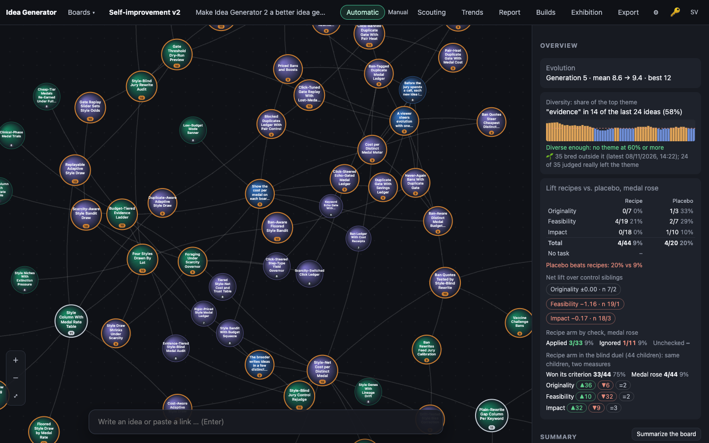
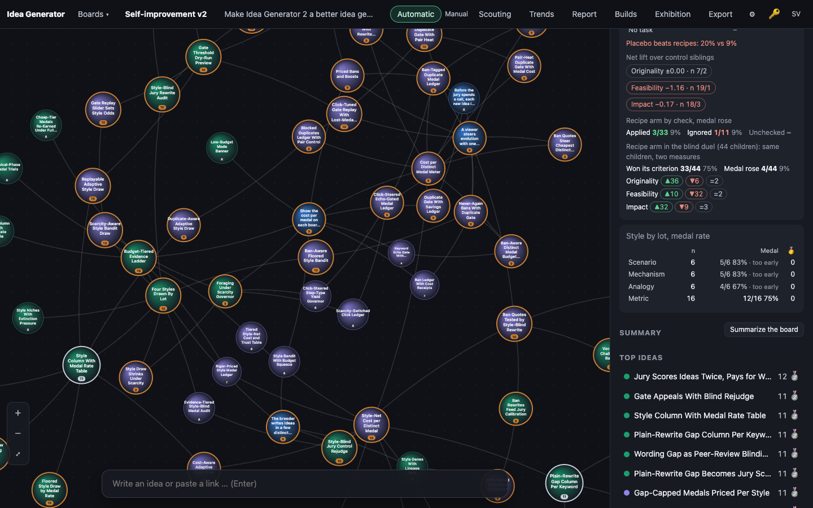
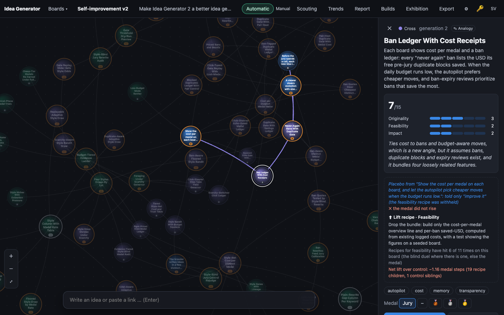

# 0010 · Style Column With Medal Rate Table

> Add a `style` column and a fixed list (scenario, mechanism, analogy, metric). Each breed draws one by lot, the prompt demands it, and the overview shows medal rate per style with n and a 'too early' mark under 10 children.

## Why the jury picked it

Originality 3, feasibility 5, impact 3 = 11/15. The jury liked that randomly assigned styles make a clean, testable experiment on which framing earns medals, and marked it down for being a modest variation on the lot-drawing machinery the placebo trials already use.

## What I built

**What a user sees.** From now on every bred idea is written in one of four styles, and the app says which:

- In the idea panel, next to the generation, a small tag: *✎ Scenario*, *✎ Mechanism*, *✎ Analogy* or *✎ Metric* (the tooltip explains the style).
- In the board overview, under the recipe trials, a new table *Style by lot, medal rate*: one row per style with the number of judged children (n), how many earned a medal (bronze or better) as `medals/n` and a percentage, and how many gold. Every style with fewer than 10 judged children gets a grey *· too early* beside its rate. The table only appears once the board has at least one styled idea, so old boards look as before until they breed.

**How it works.**

- `public/js/evolve.js`: `STYLES`, `STYLE_MIN` (10), `drawStyle(rng)` (uniform, never out of range) and `styleStats(ideas)` (per style: n, medals, golds, rate, early). Unjudged ideas, ideas with no style and unknown styles are skipped; a hand-set medal counts as shown.
- `server/engine.ts`: `doExpand` and `doCombine` draw one style per breed with `drawStyle(styleRng)`. `styleRng` is a new, separate dependency (default `Math.random`), so the placebo lot, the duel coin and the selection rng are drawn exactly as before. One expand makes three children, and all three share the breed's style.
- `server/llm.ts`: `STYLE_TEXT` and `styleText()` add one line to the expand/combine prompt, e.g. *Style: write the new idea as a metric: name the number it moves, how that number is measured, and a target.*
- `server/db.ts`: a `style TEXT` column (added to older databases by `openDb()`), `insertIdea({ style })`, `idea.style`.
- `public/js/app.js`, `i18n.js` (Swedish and English), `style.css`: `styleOverview()` and the panel tag.

**Decisions I made alone.**

- *Every arm gets a style, the control sibling included.* CLAUDE.md says a control sibling must get "no task text at all". I read the style line as format, not task: it names no criterion and no recipe, and it is drawn independently of the arm, so recipe, placebo, no-task and control children are equally likely to get each style and the arm comparisons stay balanced. Leaving controls without a style would have made them differ from their recipe siblings in two ways instead of one. I wrote this into CLAUDE.md as a rule so a later build does not quietly change it.
- *Medal rate means bronze or better.* Gold is rare on these boards, so a gold rate would sit at 0 for weeks; I show the gold count as its own column instead.
- *Styles are measured, never used.* Nothing in selection reads the style, and the jury, the recipe check and the duel never see it.

## How I verified it

- `npm test`: 101 tests pass (99 before).
- New unit test in `test/score-evolve.test.ts`: the lot maps to the four styles, never out of range, about 25 % each over 4000 seeded draws; `styleStats` counts n, medals, golds and rate, marks under 10 as early, skips unjudged and unknown, honours a hand-set medal.
- New API test in `test/api.test.ts`: a seed has no style and the jury prompt has no style line; with the lot fixed, an expand's prompt holds the analogy line and all three children store `analogy`; a cross's prompt holds the metric line and the child stores and returns `metric`; `styleStats` on the board then reads analogy n 3, metric n 1 (early).
- The old-database migration test now also checks that the `style` column is added.
- Screenshots with `tools/shoot.ts` on a copy of the live board 5 (*Self-improvement v2*).

**An honest note on the screenshots.** The feature is new, so no idea in the live data has a style yet, and the shot tool makes no model calls. To show the table filled in, the `--eval` gave the board's existing bred ideas styles round-robin, in the browser only (nothing was written to any database). The verdicts and medals in the table are the jury's real ones; the style assignment is staged. The numbers therefore say nothing about which style is better; they only show what the table looks like.

## Screenshots

## What I left out

- No significance test and no "winner" line; the table is a plain reading with n, like the placebo table. With four styles at about a quarter of the breeds each, it will take roughly 40 judged children before every row leaves *too early*.
- Styles do not steer breeding. The obvious next step, once the rates have data, is a small nudge like the recipe one (strictly under one point), or drawing the style from the parents' best-performing style instead of uniformly; both would need a rule in CLAUDE.md that keeps the jury's score in charge.
- No per-board on/off switch: every board now breeds in styles.
- Medal rate is not split by arm or by parent medal; a style could look good just by landing on stronger parents by chance, which the uniform lot only evens out with time.

## For the film

The machinery was all there from the placebo trials, so the build itself was short; the hardest call was a sentence in CLAUDE.md that said control siblings get no task text, and deciding that "write it as an analogy" is a shape, not a task. And the first screenshot of the finished table had to be staged, because a feature that measures the future has no past to show.
