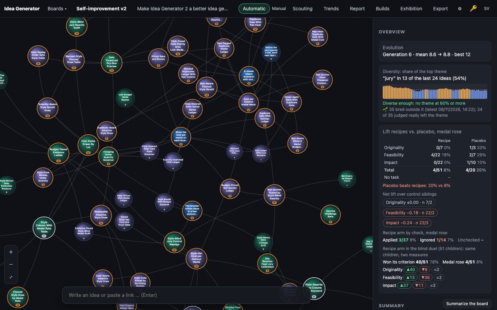
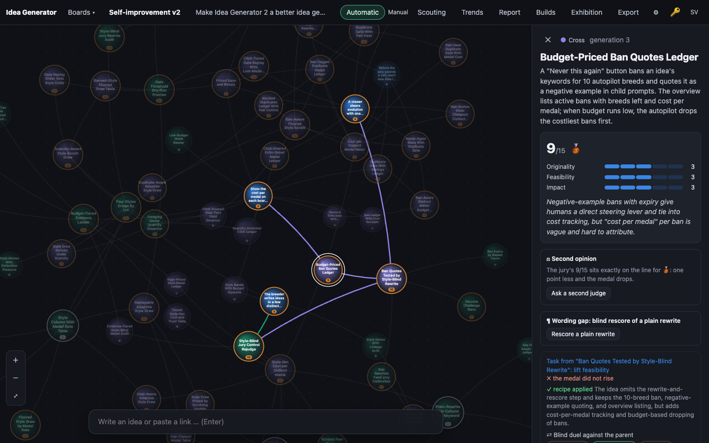
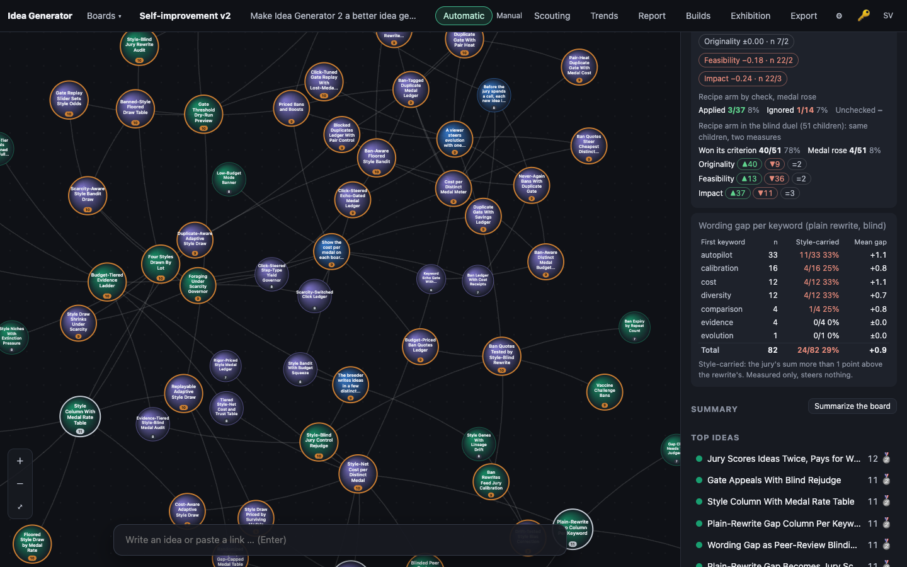
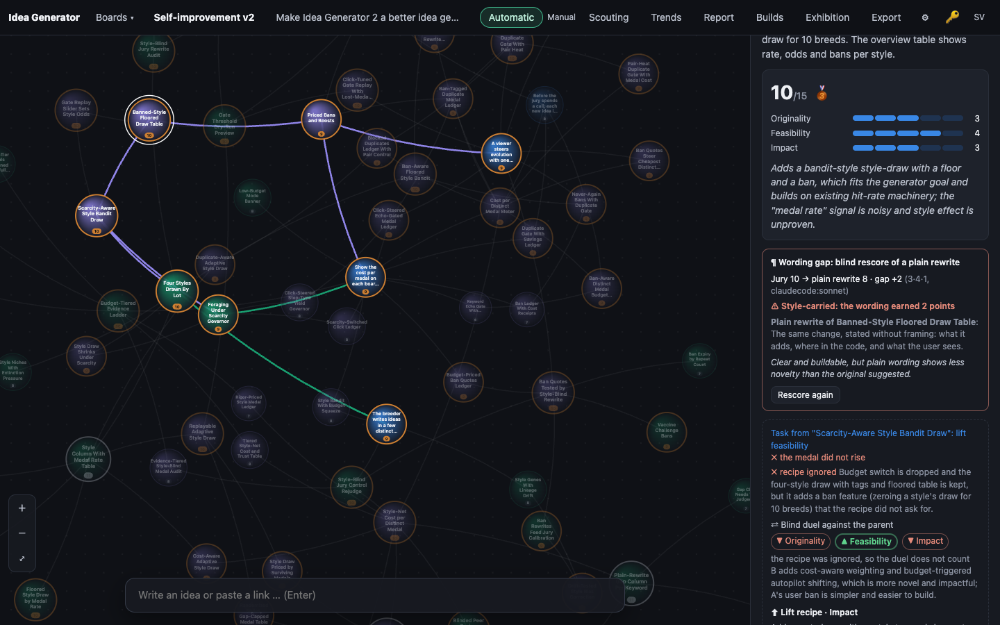

# 0011 · Wording Gap as Peer-Review Blinding Test

> Borrowing from science: like blinded manuscript review, the judge rescores a plain rewrite, and an idea whose gap exceeds one point is flagged 'style-carried'. The overview adds a per-keyword style-carried rate beside cost-per-medal, with no steering.

## Why the jury picked it

Originality 4, feasibility 4, impact 3 = 11/15 (silver on the board's ladder, sent to me as gold). The jury liked it as a fresh, honest check on itself, and warned that it costs extra judge calls per idea and that the per-keyword rate only describes. It doesn't steer.

## What I built

**What a user sees.**

- **Idea panel:** a new box, *¶ Wording gap: blind rescore of a plain rewrite*. Before a rescore it holds one button, *Rescore a plain rewrite*. After one it says e.g. *Jury 10 → plain rewrite 8 · gap +2 (3·4·1, claudecode:sonnet)* with a verdict: red *⚠ Style-carried: the wording earned 2 points*, or green *Substance holds*. Below that come the plain rewrite and the rescore's one-sentence reason.
- **Overview:** a *Wording gap per keyword (plain rewrite, blind)* table. It lists each first keyword (top 8) with n, the style-carried count and rate, and the mean gap, plus a total row. A note under it says it is measured only.
- **Board settings → Jury:** a checkbox, *Wording gap: rescore a plain rewrite after every verdict (two more calls per idea)*. It is off by default. `npm run self:setup` turns it on for new self-improvement boards.

**How it works.**

- `server/llm.ts`: the new `plainRewrite()` with `PLAIN_SYSTEM`. It keeps every concrete claim, mechanism, number and step, and strips names, metaphors, scenes, hype and adjectives that carry no fact. It may not add or fix anything. It sees only the idea's title and pitch.
- `server/engine.ts`: `plainRescore()` rewrites the idea on the judge model, then runs the ordinary `llm.judge` on the rewrite (same system prompt, goal and guidance; no first verdict). It stores only the scores, the reason, the rewrite, the model and the time in the new `plain` column. The rescore's keywords and recipe are thrown away, so they cannot leak into the idea. `judge()` calls it after the duel when the board has `wordingGap` on, once per idea. A failure is swallowed and never fails the verdict. `engine.plain()` / `POST /api/ideas/:id/plain` does it by hand on any board and can redo it.
- `server/db.ts`: the `plain` column (added to older databases), `savePlain()`, and the `wordingGap` board config flag.
- `public/js/evolve.js`: `plainGap()` (the jury's sum minus the plain sum), `styleCarried()` (gap > `PLAIN_GAP` = 1) and `wordingStats()` (total and per first keyword).
- `public/js/app.js`: `plainBlock()`, `wordingOverview()` and the checkbox. The strings are in `i18n.js` (sv/en) and the styles in `style.css`.

**Decisions I made alone.**

- **Threshold "more than one point".** The idea asks for this, and it is also right: calibration measured the Sonnet judge's run-to-run spread at 1. A gap of exactly 1 could be pure noise, so it counts as *substance holds*.
- **Off by default.** It doubles the judge calls per idea, and the existing tests on self-improvement boards count judge calls. Turning it on silently for every self-improvement board would have changed what those tests measure, and I may not weaken them. So it is a board switch. **The live board ("Self-improvement v2") does not have it on yet**: someone has to tick the box in its settings, or press the panel button by hand.
- **Gap computed live, not stored.** A re-judge keeps the rewrite (the idea's text has not changed), and the gap is always against the jury's current scores.
- **The judge model, not the second judge, does both calls.** In blinded review the same kind of reviewer reads the stripped manuscript. Using the retrial model would mix model differences into the wording gap.

## How I verified it

- `test/api.test.ts`, new test *wording gap*:
  - Off by default: no rewrite call.
  - With it on: one `plain` call on the judge model with `PLAIN_SYSTEM`, which never sees the verdict. Then a second `judgement` call whose user text holds only the rewrite (not the original wording or the first reason), with the same system prompt and the goal.
  - The medal, keywords and recipe stay the jury's, and `fitness()` still reads 12.
  - Gap +3 is style-carried and gap +1 is not.
  - A re-judge doesn't rewrite again.
  - A failing rewrite leaves no rescore, and the verdict stands.
  - The hand endpoint works (200), gives 404 for an unknown idea and 502 for an empty rewrite.
  - `wordingStats` per keyword is checked on the board.
- The old-database test checks that the `plain` column is added.
- `test/score-evolve.test.ts`, new pure test: `plainGap`, `styleCarried` and `wordingStats`. It covers negative gaps, unjudged ideas, a broken rescore, a hand-set medal, ideas with no keyword (total only) and the top-8 cut with alphabetical ties.
- `npm test`: 103 pass, 0 fail.
- Screenshots: `02-after` uses the real copied data, where no idea has a rescore yet, so the panel shows only the button. **`03` and `04` use made-up rescores** that I put into the browser state with `--eval`. The screenshot tool makes no model calls, so there was no real rewrite to show. The numbers in those two pictures show the layout only. They are not measurements.

## Screenshots

## What I left out

- **"Beside cost-per-medal".** The app has no cost-per-medal view yet: those were sibling ideas that were never built. So the table stands on its own under the style table. The next step is to show cost per medal per keyword in the same table, once the cost of each call is stored per idea.
- **No steering, on purpose.** The idea says so, and a single rescore is too noisy to steer on.
- **No "gap-adjusted medal rate"** of the kind the parent ideas suggested. That would be the next step, once a few dozen real rescores exist to check whether the gap is stable enough to subtract.
- **No calibration run of the plain rewriter.** It costs money, and the jury prompt itself is unchanged. What is worth checking next: rescore the calibration's strong ideas both as written and as plain rewrites, and see whether the gap stays above 1 for ideas that are good in substance.

## For the film

The strange part was showing it: the screenshot tool deliberately can't call a model, so for the pictures I had to invent the very numbers this feature exists to measure. They are labelled as made up. The first real wording gap will appear once someone ticks the box on the live board.
