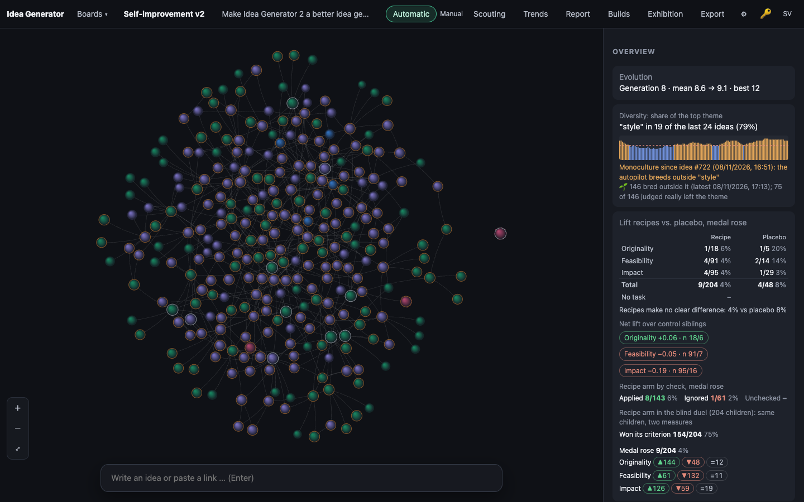
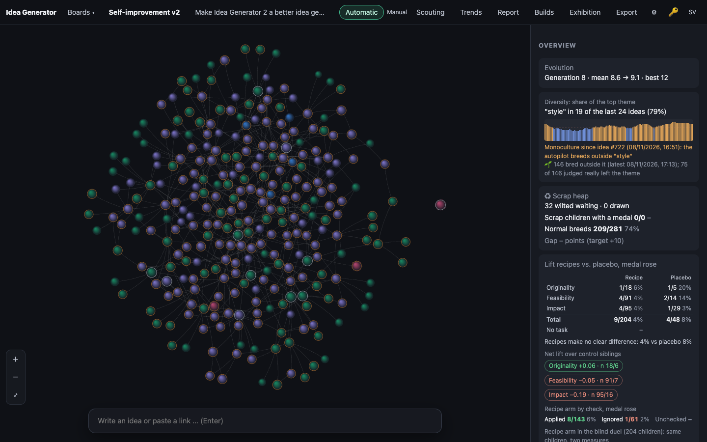
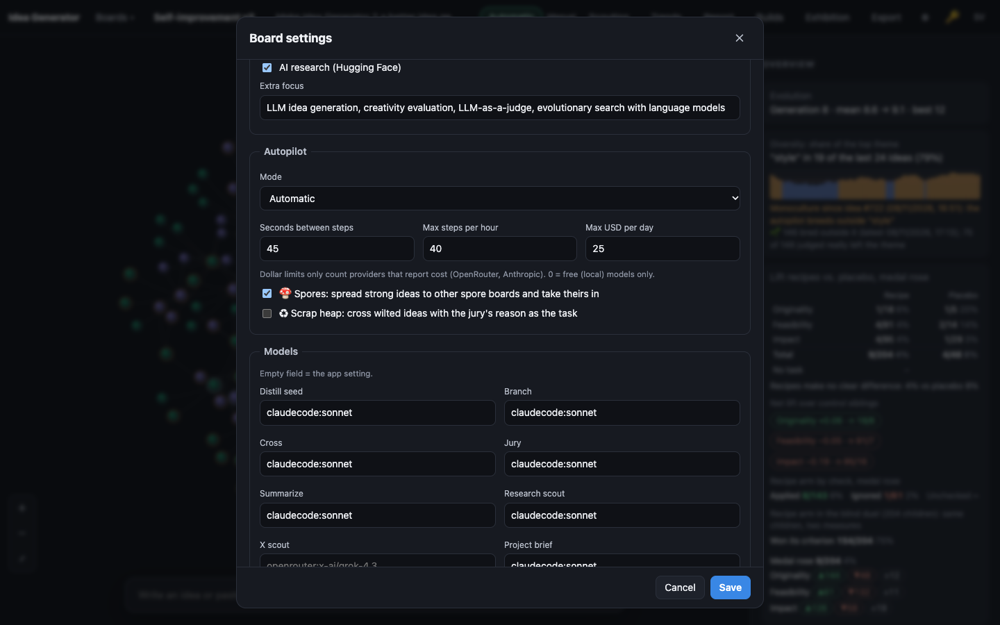

# 0012 · Scrap heap: wilted ideas crossed with their own jury reason

> **Scrap Draw Medal-Rate Gap Metric.** Metric: scrap-medal-rate gap, target ≥ +10 points over normal breeds. Idle autopilot draws a wilted idea (5+ judged children, none above own medal), weighted by keyword distance from the living pool. It crosses it via the existing cross prompt, task = jury failure reason, tagged 'scrap'. One overview card shows survivors, gap, distance and Promote.

## Why the jury picked it

Originality 4, feasibility 4, impact 3 (11/15, silver on this board, picked for building). The jury liked a new, testable mechanism: give wilted ideas another try with their own jury reason as the task, and measure the result against normal breeds. It also said the idea was vague about the thresholds and the weighting, so I had to choose those myself.

## What I built

**What a user sees.** Board settings → Autopilot has a new box, *♻ Scrap heap: cross wilted ideas with the jury's reason as the task*. With it on, the overview gets a *Scrap heap* card just under the diversity gauge:

- *32 wilted waiting · 0 drawn*
- *Scrap children with a medal 0/0* and *Normal breeds 209/281 74%*
- *Gap – points (target +10)*, which turns green or red once there is data, and reads *too early* under 10 judged scrap children
- the mean keyword distance of the draws
- the survivors (scrap children with a medal) as links that open each idea

When a draw happens, a toast says *From the scrap heap: "…" is crossed with the jury's reason as the task*. A scrap child's panel says *♻ Scrap child of "…" · keyword distance 0.83*, and the title links to the wilted parent.

**How it works.**

- `public/js/evolve.js` (pure, shared with the server):
  - `wilted()`: an own idea (not a guest), judged below gold, with a jury reason, at least `WILT_CHILDREN` (5) judged children, and none of them above its medal.
  - `keywordDistance()`: 1 minus the mean share of living ideas that carry each of the idea's keywords.
  - `scrapDue()`: true every `SCRAP_EVERY` (8) bred ideas.
  - `drawScrap()`: draws one wilted idea that has not been drawn before, by lot, weighted by distance (with a floor of 0.1 so close ideas can still come up). Its partner is the fittest living idea it has not been crossed with.
  - `scrapStats()`: bronze-or-better rate for scrap children and for normal breeds, the gap in percentage points, the mean distance, and the survivors.
- `server/engine.ts`:
  - `maybeScrap()` runs from `autoStep()` after an expand or a cross when a draw is due. It also runs at once when the autopilot had nothing else to do: that is my reading of "idle", because a busy board is almost never idle.
  - It calls the existing `doCombine()` with a forced task `{arm: 'scrap', change: <the wilted idea's jury reason>}`, then judges the child in the same step.
- `server/llm.ts`: `liftTaskText()` gives the scrap task its own wording, in the ordinary cross prompt: *The jury's verdict on "X" (an idea that has bred many children and none rose above it): … Your task: the new idea must overcome what this verdict says held it back.*
- `server/db.ts`:
  - a new `scrap` column (JSON `{from, distance, at}`), added to older databases on open
  - board config `scrapHeap`, off by default
- `tools/self-setup.ts` turns `scrapHeap` on for the default `evolution` focus.
- `public/js/app.js`, `i18n.js` (Swedish and English), `style.css`: the card, the panel line, the checkbox and the toast.

**A decision on the trials.** A scrap child stores no `lift_*` and has no trial arm. Its task is a jury reason, not a recipe. If it counted as a recipe, placebo or no-task child, it would bias the trials that builds 0004–0009 set up so carefully. I wrote this into CLAUDE.md as a rule.

## How I verified it

- `test/scrap.test.ts` adds 7 tests:
  - `wilted()`: the 5-child threshold, a riser saves the parent, unjudged children don't count, gold, guests and ideas with no reason never wilt.
  - `keywordDistance()`, including that an idea is not part of its own pool.
  - `scrapDue()`.
  - `drawScrap()`: the distance weighting, with the lot pinned on each side of the floor's share; no wilted idea is drawn twice; the partner is the fittest living idea.
  - `scrapStats()`: the rates, the gap, the mean distance and the survivors.
  - An engine test with the fake LLM:
    - The child gets both parents and the `scrap` record, with distance 1, since no living idea carries the wilted keyword.
    - The cross prompt contains the wilted idea's jury reason and the scrap task line.
    - The child is judged in the same step and has no arm, so `trialStats` and `liftStats` don't see it.
    - A second draw finds nothing.
  - An autopilot test: with the box on, a scrap child appears within a few steps; with it off, none ever does.
- `npm test`: 124 of 124 pass (117 before).
- Screenshots of board 5 (a copy of the live data, no model calls). I switched the box on in the copied database through the board PATCH endpoint. The card shows real numbers: **32 wilted ideas are waiting** on the live board.

## Screenshots

## What I left out

- **Promote.** The pitch puts a Promote button on the card. The ideas this one grew out of sent scrap children to a separate board, and there Promote moved winners back. Here they land on the same board and breed like any idea from the start, so a Promote button would have nothing to do. Making it mean something would take a quarantine: a new rule in `nextMove()` that holds scrap children back from selection until a person promotes them. That changes selection, which every earlier build has kept clear of, so I left it out. The survivors list links to each idea instead.
- **No scrap child in the screenshots.** A real draw calls the model, and the screenshot tool runs without one. The card shows its empty state with real wilted counts. The first real scrap children will appear on the live board once someone ticks the box (or a board is made with `self:setup`).
- **The target looks hard.** On this board normal breeds already earn a medal 74% of the time (bronze is easy here). So +10 points means scrap children must reach 84%. The card will show honestly whether they do. If they don't, the next step is to compare silver-or-better instead of bronze, or to compare against crosses only.
- No distance for the child itself, only for the drawn parent. Measuring whether scrap children really spread the pool's keywords would be the next metric.

## For the film

The surprise came when the after-screenshot loaded: on a board that has been running for days, 32 ideas had already wilted. The autopilot kept choosing them as parents, and not one of their children beat them. The scrap heap was already full before the code that empties it existed.
