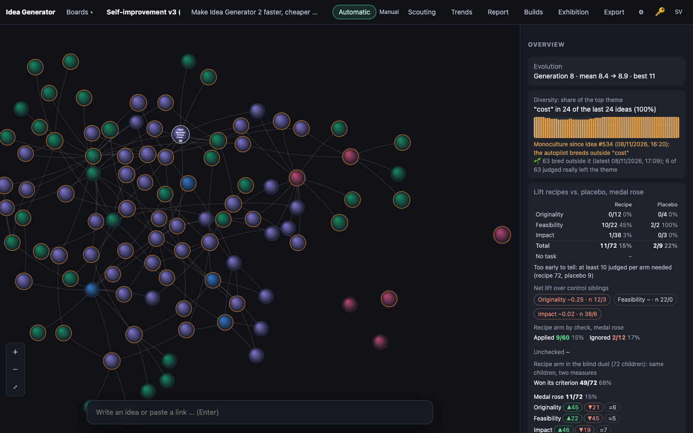
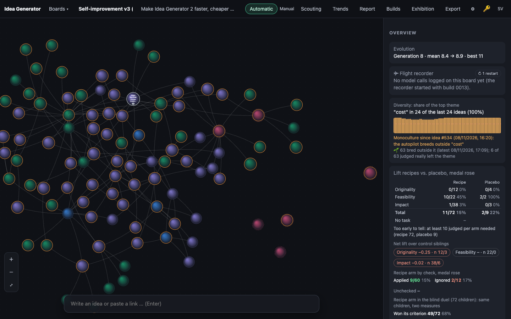

# 0013 · Flight Recorder Proves Crash Recovery

> Like an aviation black box that logs every flight and is then used to certify crash survival: the model wrapper writes each call to a SQLite `calls` table. A kill-and-restart test asserts one idea row and one judge call from it. The overview shows a restart chip and seconds and dollars per medal per role.

## Why the jury picked it

Silver, 11/15 (originality 3, feasibility 4, impact 4). The jury liked that one table gives both real per-role cost and seconds per medal and a restart guarantee you can test. It worried that the app might already track costs and that the idea was a bit broad. On the first worry: the app had a spend ledger per board and day, but nothing per role, no timings, and no way to know what a crash cut off.

## What I built

**What a user sees.** The overview has a new *✈ Flight recorder* card near the top, under *Evolution*. It shows the board's model calls, dollars and seconds in total and the number of medals. Below that, a table lists each role (judge, combine, plain, retrial, expand, duel, liftcheck, …) with its calls and dollars and seconds **per medal**, most expensive first. Failures (✗) and calls cut off by a restart (↯) appear beside the call count. A chip in the corner, *↻ N restarts · M calls cut off*, counts the server restarts since the board was made. It turns amber when a restart cut off a call on this board.

Behind the card, a crash no longer quietly drops a judgement. If the server dies while the jury is out, the next start finds the open call, marks it lost and queues that idea's judgement again, once the browser has handed over its settings.

**How it works.**
- `server/db.ts`: two new tables. `calls` holds board, idea, role, model, status (`open`/`ok`/`failed`/`lost`), usd, ms and times. `boots` gets one row per server start. `openCall()` and `closeCall()` write the call rows. `recordBoot()` turns every still-open row into `lost` and adds the boot, in one transaction, and returns the lost calls. `callStats(boardId)` sums each role and counts restarts (boots strictly after the board's `created_at`).
- `server/engine.ts`: `call()` was already the single gate every model call passed through (for the spend ledger). It now takes `{ role, ideaId, model }`, opens a row before the call and closes it after. I changed all 15 call sites. `analyzeRepo` bypassed `call()`, so it now logs itself under board 0. The spend ledger stays as it was for that call. `recover(lost)` queues a lost judge call again if its idea is still unjudged and has no hand medal. It retries a lost second opinion if the verdict is still on a medal edge and has none. It never redoes breeds, because that would add ideas.
- While wiring recovery I found a small race that recovery would have made likelier. The judge queue and an autopilot step could both judge the same idea. Now the queue skips an id that is already being judged, and the autopilot doesn't pick ids that are already queued.
- `server/index.ts`: calls `recordBoot()` right after opening the DB, and `engine.recover()` on the first settings push. Recovery is off under `IDEAGEN_NO_AUTOPILOT=1`, because a screenshot or a build's boot check runs on a *copy* of the live DB. That copy's open rows are the live server's calls in flight, and redoing them would spend real money from a worktree. `IDEAGEN_RESUME=1` forces recovery on for the crash test.
- `server/app.ts`: `recorder` on `GET /api/boards/:id`, plus a light `GET /api/boards/:id/recorder`. The browser re-fetches it (debounced 4 s) while ideas arrive.
- `public/js/evolve.js`: the pure `flightStats()` divides each role's totals by the board's medals (bronze or better). `public/js/app.js` adds `recorderOverview()`, and `i18n.js` has the strings in Swedish and English.

## How I verified it

- `test/recorder.test.ts`, 5 new tests (129 in all, all passing):
  - Every provider request gets exactly one `calls` row (share logged: 100%), with the right role, the idea it belongs to, dollars and seconds. An expand call is filed under its parent.
  - A failed call is logged as `failed`, with $0.
  - `recordBoot()` marks open rows lost, and a second boot finds nothing open. `recover()` re-judges only the cut-off idea that is still unjudged. It skips the hand-medalled and already-judged ideas and does not redo the cut-off breed.
  - `flightStats()` arithmetic, and null per medal before the first medal.
  - **The crash test.** The test spawns a real `node server/index.ts` on a temp DB and a free port, against a fake OpenAI-compatible provider that swallows judgement requests. It seeds an idea, waits until the judge request is in flight, and kills the server with `SIGKILL`. It starts the server again on the same file and checks that the idea is still unjudged. It pushes settings (the provider now answers) and waits for the verdict. Then it asserts one idea row, `restarts: 1`, `lost: 1`, the log line `resumed 1 judgement`, two requests at the provider, and in the DB exactly `judge:lost, judge:ok` for the idea.
- It passed on the first run. That made me suspicious, so I checked that the assertions could only pass if recovery really ran. The log line is printed only by `recover()`, and the provider must see a second judge request.
- Screenshots with `tools/shoot.ts` against a copy of the live DB, board 7.

## Screenshots

## What I left out

- **No `steps` table and no generic resume.** Only cut-off judgements and second opinions resume. A breed cut off mid-call is lost and the autopilot breeds again. Resuming it exactly would need the arm, style and parents stored before the call, plus a done marker in the same transaction as the insert.
- **No verdict cache or saved-dollars chip.** Several of the parent ideas wanted one. The recorder is the measurement it would need first: now we can see which role costs the most per medal.
- Per medal divides by *all* the board's medals, not the medals a role helped make. Attributing medals to the steps that produced them is the next step.
- Old calls are not backfilled. The recorder starts counting with this build, so existing boards show an empty table until the next calls arrive.

## For the film

The crash test kills a real server process with `kill -9` in the middle of a judgement, starts it again, and watches the same idea get its verdict without a second copy appearing. It passed on the first try, which made me trust it less, so I checked what it would take to fake it. While building recovery I noticed a gap in the old code where the queue and the autopilot could both judge the same idea. I never saw it happen, but recovery would have made it likelier, so I closed it.
