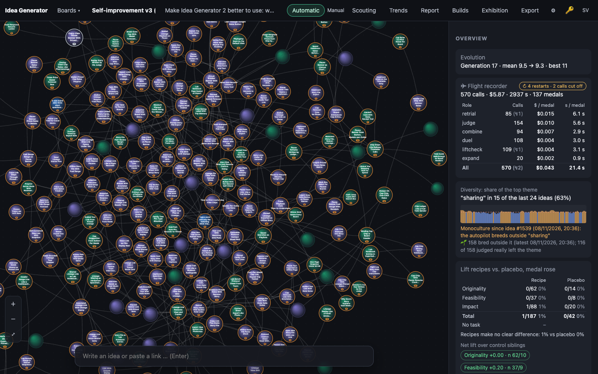
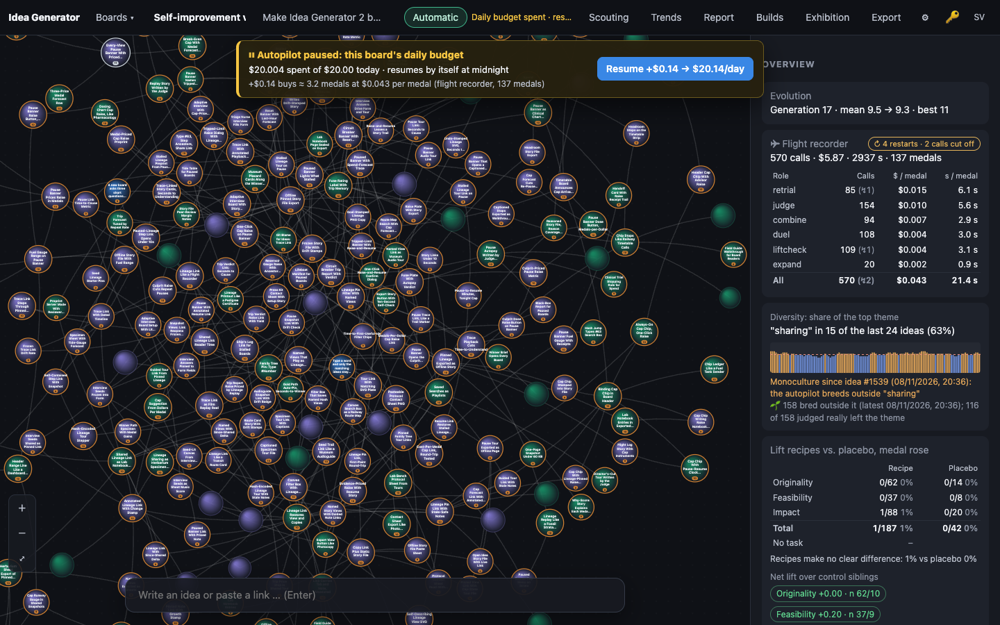
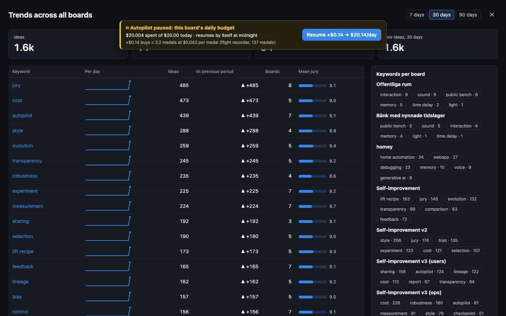
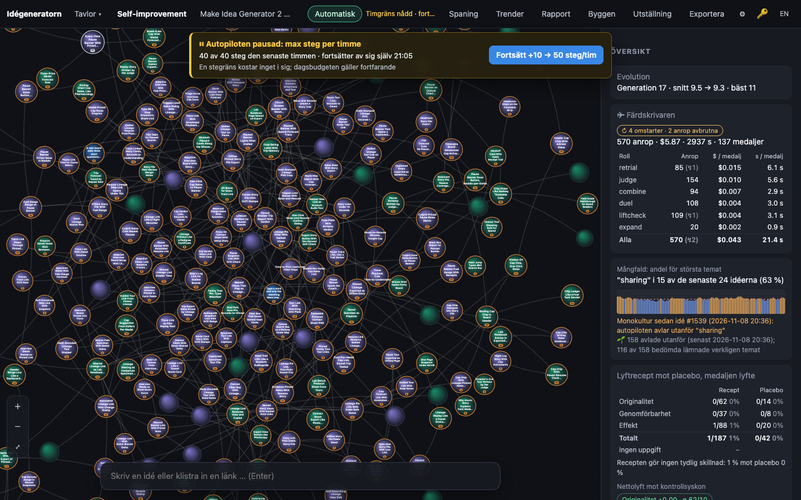

# 0014 · Every-View Pause Banner With Priced Resume

> A banner on every board view names the tripped cap, its value and resume time. One "Resume +$X" click raises that cap by X, where X is the average cost per medal times a medal target. The banner shows the forecast of medals.

## Why the jury picked it

Originality 3, feasibility 4, impact 4 = 11/15. It removes the surprise of a silently paused autopilot and gives a priced one-click way out. The jury called the banner and the cap raise familiar patterns, and pointed out that the forecast rests on thin cost data.

## What I built

**What a user sees.** Before this build, a paused autopilot showed up only as a short gold chip in the top bar ("Daily budget spent · res…"), cut off by the chip's width, and it vanished as soon as you opened Trends, Report or Builds. Now, when the autopilot stops at a cap, a gold banner sits under the top bar and stays over every view:

- **⏸ Autopilot paused: this board's daily budget**
- *$20.004 spent of $20.00 today · resumes by itself at midnight*
- *+$0.14 buys ≈ 3.2 medals at $0.043 per medal (flight recorder, 137 medals)*
- a button: **Resume +$0.14 → $20.14/day**

One click raises the cap. The button turns into "Resuming …" and the banner disappears when the autopilot's next tick (within a second) moves past the cap. The banner covers the board's daily budget, the global daily budget and the steps-per-hour cap. Backoff and errors are not caps, so they get no banner. The banner is in Swedish and English. Exhibition mode hides it, because the exhibit overlay already shows the status.

**How it works.**

- `public/js/pause.js` is new and pure, with no DOM and no network. `pauseBanner()` takes the autopilot status, the board's `rate`, the global cap and spend, and the flight recorder's cost per medal, and returns the cap, its value, today's spend, the resume time, the raise and the forecast.
  - **The price.** X = `RESUME_MEDALS` (3) × the board's total dollars per medal from `flightStats()`, the same figure the overview's flight-recorder card shows, rounded *up* to the cent so the raise never buys less than it promises.
  - **The overshoot.** The rate check runs before a step, not during one, so the spend can end above the cap (board 6 in the screenshot: $20.004 of $20). Raising a $20 cap by $0.13 would barely clear $20.004. So the new cap is today's spend plus X, and the forecast counts only the room above the spend: 3.2 medals, not a flat 3.
  - **No cost data.** On a new board, or one on free models, the raise is +25% (at least $0.50) and the banner says plainly that it is not priced. The step cap is raised by 25% (at least 5) and is never priced, because the recorder knows dollars per medal, not steps per medal.
- `public/js/app.js`: `renderPauseBanner()` is called from `renderAutopilot()`, so it runs on every autopilot event and every countdown second. It rebuilds the DOM only when its text changes. My first draft rebuilt it every second; I caught on rereading that a click landing mid-rebuild could be swallowed. `resumeAt()` PATCHes `config.rate` with only the raised field (`mergeConfig` keeps the other one). A global cap goes through `saveSettings`, because it lives in the browser. A guard re-enables the button if the resume has not taken effect after 10 s.
- `public/index.html` and `style.css`: `#pause-banner` is fixed at z-index 35, above the overlay views (30) and below menus (40).
- No server change. The autopilot already re-checks the caps every second, so raising the cap is enough to resume.

## How I verified it

- `test/pause.test.ts` adds 8 tests:
  - no banner for manual, running, idle, pace, error and backoff
  - the priced raise (3 × $0.043 → +$0.13)
  - overshoot past the cap
  - the +25% / $0.50 fallback, including a $0 "free models only" cap
  - the global cap
  - the hourly step raise
  - the price taken from `flightStats()` exactly as the overview computes it
  - an integration test: a real `createAutopilot` on an in-memory DB stops at `board_budget`, the banner's raise is applied the way `resumeAt()` sends it (`{ rate: { usdPerDay } }`), the step cap stays at 40, and the next tick takes a step.
- `npm test`: 140 tests pass (132 before).
- Screenshots with `tools/shoot.ts` against a copy of the live data. Its autopilot is off, so I set a paused status through `window.ideagen.state()` with `--eval` and let the countdown tick draw it. In the screenshots I checked the figures against the flight-recorder card next to it ($0.043 per medal, 137 medals). I also checked that the banner sits on top of the Trends overlay and that the Swedish strings fit.
- What I could not verify: an actual click in a browser against a live paused board. The shoot tool takes still pictures, and the click path (`patchBoard` → PATCH → next tick) is covered by the integration test rather than seen.

## Screenshots

## What I left out

- **Forecast vs actual.** Comparing the forecast with the medals actually earned after a resume, as one parent idea proposed, would need the raise to be logged server-side. That is the natural next step: a `resumes` row with the forecast, then a line in the flight-recorder card.
- **An uncertainty range** on the forecast. Cost per medal is a plain mean. With 137 medals it is fair, but with 3 medals it is thin, and the banner only shows the basis ("137 medals") rather than a range.
- **Pricing the hourly cap.** That would need steps per medal.
- **A confirm step.** The parent ideas had one. I left it out, because the button already names the exact raise and the new cap, which was the idea's "one click".
- **Lineage trace links and saved views**, which several parent ideas mixed in, are separate features.

## For the film

The banner worked on the first screenshot, but the number on the button was $0.14, not the $0.13 I expected from 3 × $0.043. It took a moment to see why: the board had already spent $20.004 of its $20 cap, and the code was right to charge for that overshoot.
